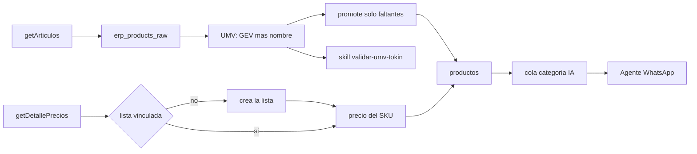

# 127 — Alta automática del catálogo ERP

**Estado:** Borrador  
**Fecha:** 2026-10-20  
**Repos:** `backend-supabase` (`erp/connectors/gev.py`, `erp/services/erp_product_promote_service.py`, `erp/services/erp_sync_service.py`)  
**Rama sugerida:** `feat/erp-alta-catalogo-automatica`  
**Relaciona:** [022](./022-erp-integraciones-cierre-loop-producto.md), [118](./118-mcp-erp-gev.md)  
**Tenant de prueba:** `almaro` (GEV). El alta genérica corre en todo tenant con `pull_products`.  
**Prueba de unidades:** skill `validar-umv-tokin`. Tokin es el oráculo del pack.

---

## Objetivo

Cada artículo que la API del ERP devuelve, y del que tenemos unidad de venta y precio, queda en `{tenant}.productos` al terminar el job de las 6 horas. Hoy el job solo refresca `erp_products_raw`. El alta a `productos` es manual. Un SKU nuevo queda invisible para WhatsApp hasta que alguien lo promueve. Si al promoverlo se inventa la unidad, el agente cobra mal.

En Almaro, el 2026-10-20, la API traía 13 artículos que no estaban en `productos`. Se promovieron a mano. Este spec evita el próximo hueco.

El [022](./022-erp-integraciones-cierre-loop-producto.md) prohíbe que un job cree productos, clientes o listas. Se automatiza la entidad cuando están los datos clave de esa entidad. Si falta uno, la fila se queda en el espejo. No se inventa el dato.

Para un producto, los datos clave son la unidad de venta y el precio. El bulto y el display que GEV no manda se leen del nombre, con la regla de abajo, y se contrastan contra Tokin. La categoría se asigna después, con una IA que elige entre las que ya existen. La imagen no se carga. El cliente sigue siendo alta humana porque a GEV le falta el teléfono. La lista de precios, si falta y un producto nuevo la necesita, se crea en el mismo job.

### Criterios de aceptación

- Después del job, todo SKU recién bajado está en `productos`. Entra al catálogo solo si cierra el checklist. Si falta un dato, queda apagado y hay una notificación.
- El alta no pisa `nombre`, `descripcion`, alias, imagen ni UMV de un producto que ya existe.
- Ningún alta de un producto `UN` escribe `unidades_por_bulto = 1` como relleno. Si el nombre trae el bulto, se escribe ese número. Si no lo trae, el factor queda null. En un `BU`, el 1 es el factor real: el precio ya es el bulto.
- Si el precio está en una lista que no existe, el job la crea y después escribe el precio. Si el detalle no trae precio, el SKU no se promueve.
- En el mismo ciclo, ese SKU recibe el precio.
- Después del alta, la cola de categoría le asigna una categoría existente, o lo deja para el ciclo siguiente si la IA no elige un id válido.
- `image_url` queda vacío.
- Si OpenAI no responde, la descripción es el nombre recortado a 15 palabras. El alta no falla por eso.
- Un artículo con `ACTIVO` distinto de `"1"` se crea con `en_catalogo = false`.
- El job no crea clientes.
- La skill `validar-umv-tokin`, sobre los anclas de la sección de CI, da `ok` en todos.

---

## Qué trae la API y qué falta para el alta

Fuente de artículos: snapshot `implementacion/almaro/inputs/gev-articulos-20261001.json` (3300 filas de `GET /articulos/getArticulos/`) y el ejemplo de `backend/docs/external/gev_erp.md`. El conector hoy se queda con tres campos.

### Campos de `getArticulos`

| Campo GEV | Cobertura en el snapshot | Qué hace el conector hoy | Qué alcanza para el alta |
|---|---|---|---|
| `CODIGO_ARTICULO` | 3300/3300 | `sku` | `productos.product_code`. Obligatorio. |
| `DESCRIPCION_ARTICULO` | 3300/3300 | `nombre` | `productos.nombre`, y el pack cuando el texto trae `N x peso` o `A x B x peso`. |
| `STOCK` | 3300/3300 | `cantidad` | `productos.stock` en el insert. |
| `UNIDAD_VENTA` | 3300/3300. `UN` 1889, todos con cantidad 1. `DI` 1297, 1072 con cantidad mayor a 1. `BU` 114 | se descarta | Unidad del precio: `unidad` o `display`. |
| `CANTIDAD_UNIDADES_UNIDAD_VENTA` | En `UN` siempre es 1. En `DI` es el pack de adentro cuando es mayor a 1 | se descarta | En `DI` mayor a 1 va a `unidades_por_display`. En `BU` no va a `unidades_por_bulto`. |
| `UNIDAD_MINIMA_VENTA` | 2804 son 1. 86 enteros mayores a 1. 4 fracciones. 406 vacíos o 0 | se descarta | Entero ≥ 1 → `cantidad_minima_de_venta`. Fracción o vacío → 1. |
| `ACTIVO` | 3300/3300 | se descarta | Si no es `"1"`, `en_catalogo = false`. |
| `ID_RUBRO` y el resto de ids | códigos, sin nombre | se descartan | No alcanzan para crear una categoría. |
| Descuentos y `OM_TIPO` | no discriminan | se descartan | No entran al alta. |

### Precio y lista

| Endpoint | Qué aporta | Hueco que cierra este spec |
|---|---|---|
| `getDetallePrecios` | `ID_LISTA_PRECIO`, `CODIGO_ARTICULO`, `PRECIO_NETO_SIN_IMPUESTOS` | El precio se escribe en el mismo ciclo del alta. Neto × 1,21. Sin fila de precio, el SKU no se promueve. |
| `getListaPrecios` | id, descripción, activo | Si el precio del SKU nuevo apunta a una lista que Suplai no tiene, el job la crea con ese encabezado y después escribe el precio. No se crean listas que ningún SKU nuevo usa. |

### Lo que no se completa en el alta

| Dato | De dónde sale |
|---|---|
| Alias y nombre comercial | Curaduría. El nombre GEV no alcanza para el recall del kiosco. |
| Imagen | No se carga. `image_url` queda null. |
| Categoría nueva | La IA elige una categoría que ya existe. No se crea una desde `ID_RUBRO`. |
| Cliente | Alta humana. A GEV le falta el teléfono. |

## Campos que el agente necesita

Dejar la unidad en “unidad por uno” hace que un bulto cuente como una unidad. El agente solo entiende `umv_tipo` `unidad` o `display`. Si llega `bulto`, el pedido lo baja a `unidad`. “Unidad” en el pedido es la unidad mínima, no la pieza de adentro. “Bulto” multiplica por `unidades_por_bulto` si la mínima es unidad, o por `displays_por_bulto` si la mínima es display. Un factor null hace preguntar. Un 1 inventado no pregunta: entrega una unidad.

| Campo | Regla de alta |
|---|---|
| `product_code`, `nombre` | Código y descripción. Obligatorios. |
| `en_catalogo` | `ACTIVO = "1"` → true. Otro valor → false. |
| `precio_unidad` | Detalle de precios. Si falta la lista, se crea y después se escribe el precio. Sin precio, no hay alta. |
| `stock` | Se copia. Stock 0 no bloquea el alta. |
| `umv_tipo` + factores | La tabla de abajo. |
| `cantidad_minima_de_venta` | Entero ≥ 1. Fracción o vacío → 1. El turrón `4013` queda en 10. |
| `descripcion` | Quince palabras desde el nombre, o el nombre recortado si OpenAI falla. |
| `image_url` | null. |

### Mapeo de unidades

La unidad del precio sale de `UNIDAD_VENTA`. El pack que esa API no manda sale del último `N x peso` o `A x B x peso` del nombre. El peso no es un factor. No se escribe 1 cuando el patrón no está.

| `UNIDAD_VENTA` | Nombre | `umv_tipo` | `unidades_por_display` | `displays_por_bulto` | `unidades_por_bulto` |
|---|---|---|---|---|---|
| `UN` | `N x peso` | `unidad` | null | null | N |
| `UN` | `A x B x peso` | `unidad` | B | A | A × B |
| `UN` | sin patrón | `unidad` | null | null | null |
| `DI`, cantidad K > 1 | `N x peso` | `display` | K | N | N |
| `DI`, cantidad K > 1 | `A x B x peso` | `display` | K | A | A |
| `DI`, cantidad 1 | `A x B x peso` | `display` | B | A | A |
| `DI`, cantidad 1 | `N x peso` | `display` | null | N | N |
| `DI` | sin patrón | `display` | K si K > 1, si no null | null | null |
| `BU` | cualquiera | `unidad` | null | null | 1, texto “bulto” |
| vacío | — | no se promueve | — | — | — |

`BU`: la cantidad de adentro (30, 256, 720) no se copia a `unidades_por_bulto`. Un bulto pedido sería esa cantidad de bultos.

Ejemplos ya contrastados con Tokin (skill, 2026-10-20):

| Código | Nombre GEV | Regla | Resultado | Tokin |
|---|---|---|---|---|
| 14336 | Surtido Diversión `21x400` | `UN` + `N x peso` | unidad, bulto 21 | Display 1, bulto 21 unidades |
| 14361 | Serranitas `14x3x105` | `DI` cantidad 3 + `A x B` | display, 3 por display, 14 por bulto | Bulto 14. El 3 lo aporta GEV; Tokin cuenta el tripack como 1 |
| 4013 | Turrón `4x50x25` | `UN` + `A x B` | unidad, 50 por display, 4 displays, bulto 200 | Display 50, bulto 4 displays |
| 1009 | Rocklets `12x24x20` | `UN` + `A x B` | 24 por display, 12 displays, bulto 288 | Display 24, bulto 12 displays |
| 5312 | Cofler Block `8x20x38` | `UN` + `A x B` | 20 por display, 8 displays, bulto 160 | Display 20, bulto 8 displays |
| 10204 | Criollitas `22x3x100` | `DI` cantidad 1 + `A x B` | display, 3 por display, 22 por bulto | Display 3, bulto 22 displays |

Un desacuerdo que la skill deja en `diff` y el alta nueva igual aplica la regla: Mana `7208` `12x3x131`. La regla arma bulto 36. Tokin dice bulto 12 unidades, porque el 3 ya es la unidad que se vende. No se special-casea en el mapper. El test lo mantiene visible.

Los productos ya curados no se pisan, aunque el nombre y Tokin digan otra cosa. Minitorta `2987` está cargada con bulto 12 y Tokin dice 21: se queda en 12.

---

## Decisiones de diseño técnico

| Decisión | Elección | Por qué | Alternativa descartada |
|---|---|---|---|
| Quién crea el producto | `promote_erp_products_bulk` al final de la bajada, dentro de `run_erp_sync_job`, si `pull_products` está activo | El filtro “solo si no existe” ya está | Un job nuevo, o promover desde el router |
| Qué se persiste del artículo | El conector GEV pone en `extra` unidad de venta, cantidad, unidad mínima, activo y el nombre | Sin `extra`, el promote no puede armar la UMV | Guardar el JSON crudo sin mapear |
| UMV | La tabla de arriba: unidad de GEV, y el pack del nombre cuando el patrón está | GEV no manda displays por bulto ni, en un `UN`, unidades por display. En 13 anclas Tokin coincidió. Pedirle esos dos campos a GEV queda como mejora, no como traba del alta | Dejar el bulto null en todo `UN`. Escribir bulto 1. Parsear el nombre sin mirar `UNIDAD_VENTA` (`6X959G` no son 6 unidades) |
| Oráculo del pack | Tokin, con la skill `validar-umv-tokin` | La conversión publicada (“Display de N”, “Bulto de M”) es el pack comercial. El catálogo curado a veces está incompleto | Usar solo la fila ya cargada en `productos` como verdad |
| Productos que ya existen | No se actualizan nombre, descripción, alias, imagen ni UMV | El top 100 ya está curado. Pisar `2987` lo cambiaría de 12 a 21 sin una revisión humana | Backfill de UMV sobre las tres mil filas |
| UMV default vieja | Un pase único sobre filas que siguen en `unidad`, bulto 1 y sin display. Se les aplica la misma función. Si el nombre no trae pack, el 1 de un `UN` pasa a null | Esas filas las escribió el promote viejo | Corregir también las UMV ya curadas |
| Precio y lista | Hay alta si hay precio. Si la lista no está vinculada, el job la crea con el encabezado de `getListaPrecios` y después escribe el precio del SKU nuevo | El importe no se inventa. La lista sí se puede crear con los datos que ya llegan | Dejar el producto afuera hasta vincular la lista a mano, o crear todas las listas del ERP |
| Categoría | Cola después del alta. La IA elige una categoría existente (id, nombre, padre). Si el id no está en la lista, no se inserta y sigue en la cola | Sin categoría no se navega en la tienda. `ID_RUBRO` no tiene nombre | Crear una categoría por cada id de rubro |
| Imagen | `image_url` queda null | La tienda ya muestra un placeholder | Copiar o scrapear fotos en este PR |
| Regla del 022 | Se automatiza el producto cuando hay unidad, y la lista cuando hace falta para escribir el precio. El cliente sigue manual | Inventar teléfono o un importe es peor que el hueco | Mantener la prohibición total |
| Otros ERP | Sin `extra` de unidad no se promueve. Esta entrega solo llena ese extra en GEV | Sin unidad, el alta caería en unidad × 1 | Promover igual con el default |



---

## Checklist de publicación

`en_catalogo` queda en true solo si `ACTIVO = "1"` y no falta nada de esta lista. El aviso va a `{tenant}.ia_tickets` con el prefijo `[ERP_CATALOGO]`. Claude lo lee con `listar_avisos_catalogo`. La guía `alta-catalogo` dice que hay que mirar esos avisos al empezar.

| Falta | Qué pasa |
|---|---|
| Unidad de venta | Se crea apagado. El aviso dice que hay que cargarla a mano y que la próxima corrida no la completa, porque el producto ya existe. |
| Pack en el nombre sin factor | Igual que la unidad. No se inventa el bulto. |
| Precio ausente o menor a $10 | Apagado. El aviso trata el importe bajo como un posible error del ERP. |
| Descripción que agrega palabras que no están en el nombre | Se descarta y queda una frase armada solo con el nombre y la unidad. Si esa frase no tiene al menos dos palabras de producto, queda apagado. |
| Categoría | La IA elige una existente y dice confianza alta, media o baja. Solo alta se guarda. Si no, queda apagado. |
| Imagen | No se carga. Un aviso aparte dice que entraron productos sin foto. No los apaga. |
| Alias | Como mucho dos, sacados del nombre. No frenan el alta. |

La unidad, el precio, la descripción, la categoría y volver a prender el catálogo se completan por el MCP: `previsualizar_unidad_producto`, `previsualizar_precios`, `previsualizar_aliases`, `previsualizar_categoria` y `previsualizar_ocultar_producto` con `visible=true`.

## Qué pedirle a GEV para un alta más sana

`getArticulos` no trae nombre comercial, marca, descripción larga ni el nombre del rubro. Los factores de bulto y display se infieren del texto. El pedido a desarrollo de GEV está en el reporte de esta entrega: nombre como el de Tokin, marca, rubro con nombre, descripción, y unidades de conversión como números, no como un patrón dentro del nombre.

## Alcance

### Incluido

- GEV guarda en `extra` unidad de venta, cantidad, unidad mínima, activo y nombre.
- Función pura de UMV, la de la tabla, compartida por el promote y por el pase del default viejo.
- El job crea el SKU nuevo aunque falte unidad o precio. Esos huecos lo dejan apagado y se avisan.
- Descripción que no inventa datos, como mucho dos alias, vector, `image_url` null.
- Categoría existente solo con confianza alta. Si no, el producto queda apagado.
- La skill y el script que contrastan esa UMV contra Tokin.

### Fuera de alcance

- Imágenes.
- Alias y reescritura de descripciones ya curadas.
- Crear categorías nuevas.
- Crear clientes.
- Crear listas que ningún producto nuevo necesita.
- Borrar un producto que desapareció de la API.
- Inventar un importe.
- Pisar la UMV de un producto que ya no está en el default viejo.
- Pedirle a GEV los factores de conversión como condición para salir. El nombre más Tokin alcanzan para esta entrega.

---

## Orden de implementación

Un solo PR en `backend-supabase`, rama `feat/erp-alta-catalogo-automatica` desde `origin/main`.

1. `GEVConnector.fetch_products` llena `extra`.
2. Función pura `mapear_umv`, igual a la del script de la skill. El promote la usa y no pisa existentes.
3. Cola de lista: si el precio del SKU nuevo apunta a un `erp_list_id` sin fila, el job crea la lista y después escribe el precio. Sin precio, el producto se crea apagado.
4. `run_erp_sync_job` llama al promote al final de la bajada de productos y de precios.
5. Pase único de UMV sobre el default viejo, con la misma función.
6. Cola de categoría.

No hay PR de backoffice ni del agente. La skill vive en este repo (`platform`).

---

## Migración de base de datos

Sin migración de schema. `erp_products_raw.raw_payload` ya es jsonb. `productos` no gana columnas.

El pase de UMV es un `UPDATE` sobre filas que siguen en `unidad`, bulto 1 y sin display. El log del job lista los `product_code` tocados para poder volver a `unidad` / bulto 1.

---

## Plan de prueba en CI/CD

Los tests de unidad viven en `backend-supabase/tests/erp/`. No pegan a GEV, a Tokin ni a la base. La función de mapeo se prueba con los anclas de abajo, que son el resultado ya corrido contra Tokin. El script de la skill es el que vuelve a pegarle a Tokin cuando cambia la regla.

| Caso | Entrada | Resultado |
|---|---|---|
| Unidad y bulto | `UN`, cantidad 1, nombre `SURTIDO DIVERSION 21x400gr` | unidad, upb 21, upd null, dpb null |
| Unidad sin pack | `UN`, cantidad 1, nombre sin `x` | unidad, upb null. No escribe 1 |
| Unidad con mínimo | `UN`, cantidad 1, mínima 10, nombre `TURRONES 4X50X25 G` | unidad, upd 50, dpb 4, upb 200, min 10 |
| Display de GEV y bulto del nombre | `DI`, cantidad 3, nombre `SERRANITAS 14X3X315G` | display, upd 3, dpb 14, upb 14 |
| Display que el nombre completa | `DI`, cantidad 1, nombre `CRIOLLITAS 22X3X100G` | display, upd 3, dpb 22. No deja upd null |
| Display sin pack en el nombre | `DI`, cantidad 18, nombre sin `x` | display, upd 18, dpb null |
| Bulto | `BU`, cantidad 30, nombre con o sin pack | unidad, upb 1, texto bulto. upb no es 30 |
| Sin unidad | `UNIDAD_VENTA` vacío | No mapea. El promote no inserta |
| Mana, queda en diff | `UN`, nombre `GALL. OFERTA MANA 12X3X131G` | la regla da upb 36. El test de la función afirma 36. La skill contra Tokin afirma `diff` (Tokin dice 12) |

Además:

- Un segundo promote del mismo código no cambia descripción ni UMV.
- `ACTIVO` distinto de `"1"` inserta con `en_catalogo = false`.
- Sin fila de precio, no inserta.
- Precio en una lista no vinculada: se crea esa lista, se escribe el precio, y el producto entra. No se crea una lista que ningún SKU nuevo usa.
- La cola de categoría persiste el id que devuelve el doble de la IA si ese id está en la lista. Si devuelve un id que no está, no inserta.
- `image_url` del insert es null.
- `fetch_products` afirma en `extra` unidad de venta, cantidad, unidad mínima, activo, código, nombre y stock.
- El job no llama alta de clientes.

---

## Plan de prueba humana

1. Correr la skill sobre los anclas, con red:

```bash
python .cursor/skills/validar-umv-tokin/scripts/comparar_umv_tokin.py \
  --gev implementacion/almaro/inputs/gev-articulos-20261001.json \
  --codes 14336,7048,13315,3312,14772,14361,14611,4013,12626,1009,5312,10204
```

Los doce tienen que salir `ok`. `7208` tiene que salir `diff`.

2. En staging, o con el job a mano en `almaro`: anotar un SKU que esté en el espejo y no en `productos` (o borrar uno de prueba).
3. Correr la bajada y el promote. Si el nombre es `N x peso` y GEV dice `UN`, el bulto es N. Si GEV dice `DI` con cantidad 18 y el nombre no trae bulto, queda display 18 y bulto null. Si dice `BU` con cantidad 30, `unidades_por_bulto` es 1, no 30.
4. Si el precio está en una lista que Almaro no tiene, esa lista aparece y el precio del SKU también, en el mismo ciclo. Sin precio en el detalle, el SKU no entra a `productos`.
5. `image_url` queda vacío. La categoría queda asignada o en la cola, no inventada.
6. `5312` y `4013` conservan descripción, alias y la UMV que ya tenían.
