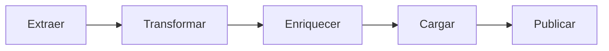

# 128 — ETL de alta de catálogo

**Estado:** Borrador  
**Fecha:** 2026-10-21  
**Repos:** `backend-supabase` (pipeline, API, MCP privado, worker) y `suplai-platform` (skill del Grok Bot)  
**Rama sugerida:** `feat/erp-alta-catalogo-automatica` en los dos repos, desde `origin/main`  
**Relaciona:** [127](./127-alta-automatica-catalogo-erp.md), [117](./117-mcp-canal-erp-o-carga.md)  
**Tenant de prueba:** `almaro` (GEV + playbook Tokin). El pipeline corre en todo tenant con alta de catálogo. Sin playbook, Enriquecer no corre.

---

## Objetivo

Un producto nuevo del ERP entra al catálogo solo cuando el agente de WhatsApp puede encontrarlo y venderlo. El ERP trae datos sucios. Una fuente limpia (en Almaro, Tokin) completa nombre, descripción, imagen, conversión y la categoría de Suplai. El mismo proceso sirve para el próximo ERP: cambia el adaptador de transformación y, si hay una fuente limpia, el playbook. No cambia la puerta de escritura ni el agente.

El [127](./127-alta-automatica-catalogo-erp.md) ya inserta el SKU, mapea la unidad, copia el precio y apaga el catálogo si el checklist no cierra. Este spec agrega las etapas de enriquecimiento, carga y publicación, y les saca al job la elección de categoría.

### Criterios de aceptación

- Todo SKU nuevo abre una fila en `core.catalogo_alta`. Un SKU que ya estaba en `productos` no se toca y no abre fila.
- Si el tenant tiene playbook, el agente corre para ese SKU. Tokin, cuando la ficha coincide por `productReference`, pisa nombre, descripción, imagen y conversión que escribió la transformación. El precio no se toca.
- La categoría la elige el agente entre las que devuelve `listar_categorias_suplai`. Un id que no está en la lista se rechaza. No se crean categorías.
- `proponer_ficha` escribe solo mientras la fila está abierta. Una segunda propuesta no pisa la ficha.
- El catálogo se prende solo si el checklist del 127 cierra después de la carga. La descripción que viene de Tokin no pasa por el filtro que descarta palabras ajenas al nombre del ERP.
- Si Tokin no tiene el artículo, la fila queda para reintentar hasta 3 veces y el producto sigue apagado.
- El MCP de Claude no gana tools. Sigue en 52. El agente de enriquecimiento usa otro MCP, con tres tools, sobre la misma API.
- Los tests de CI no llaman a Grok, a Tokin ni a la base. La prueba con el Grok Bot es el paso humano de este spec.

---

## El proceso



| Etapa | Quién | Qué deja |
|---|---|---|
| Extraer | El conector del ERP, como hoy | El documento del vendor en el espejo. No decide catálogo. |
| Transformar | El adaptador de ese ERP. GEV es el primero y ya está en el 127 | Una fila en `productos` y una fila abierta en `core.catalogo_alta` con los huecos. Sin categoría. Sin ticket de imagen si hay playbook. |
| Enriquecer | Un worker llama al modelo con el playbook del tenant. El Grok Bot puede tomar la misma fila por el MCP privado | Una propuesta. No escribe `productos`. |
| Cargar | `aplicar_propuesta` | Nombre, descripción, marca, imagen, conversión parseada y categoría, si la fila sigue abierta. |
| Publicar | El checklist del 127 | `en_catalogo` y el aviso de lo que siga faltando. La fila se cierra. |

Sin playbook, Enriquecer no corre. La categoría queda vacía, el checklist no cierra y el producto se publica apagado, con el aviso de categoría para cargarla a mano. El job no vuelve a elegir una categoría por su cuenta en ningún tenant.

El worker y el Bot compiten por la fila con un `UPDATE … WHERE etapa = 'transformado'`. El que no la gana no escribe.

---

## Ficha y propuesta

La transformación produce esta ficha. El playbook no ve columnas del ERP.

| Campo | Origen en GEV | Lo puede pisar Tokin |
|---|---|---|
| `product_code` | `CODIGO_ARTICULO` | No |
| `nombre` | `DESCRIPCION_ARTICULO` | Sí |
| `descripcion` | Nombre recortado, sin hechos inventados | Sí |
| `precio_minimo` | Neto × 1,21 de la lista vinculada | No |
| `umv_tipo`, `upd`, `dpb`, `upb`, `caja_semantica` | `mapear_umv` | Sí, si Tokin trae la conversión |
| `image_url` | null | Sí |
| `categoria_id` | vacío | Sí, un id de Suplai |
| `faltantes` | unidad, conversión, precio, precio bajo, descripción, categoría | Se recalculan al publicar |

La propuesta que acepta la API:

| Campo | Regla |
|---|---|
| `encontrado` | `false` si ninguna referencia coincidió. No se escriben campos comerciales. |
| `referencia` | El `productReference` exacto, o null |
| `url` | La URL de búsqueda que respondió, o null |
| `nombre`, `descripcion`, `marca`, `image_url` | Texto copiado de Tokin. `image_url` tiene que ser `https`. Vacío significa que Tokin no lo trae. |
| `conversion_1`, `conversion_2` | El texto crudo de «Descripción de Conversión 1» y «2». La API los parsea. No acepta un `unidades_por_bulto` suelto. |
| `categoria_id` | Un id de `listar_categorias_suplai`, o null |

El parser de conversión es el de la skill `validar-umv-tokin`:

- `Display (1 Unidad)` → la venta es por unidad. El 1 no se copia a `unidades_por_display`.
- `Display (K Unidad)` con K > 1 → `umv_tipo = display`, `unidades_por_display = K`.
- `Bulto (N Unidades)` → `unidades_por_bulto = N`.
- `Bulto (N Displays)` → `displays_por_bulto = N`.
- Un texto que no matchea no escribe factores.

`marca` entra como alias, como máximo uno, y no se suma a los dos alias que ya haya puesto la transformación. El tope sigue siendo 2.

---

## Playbook Tokin

Vive en código, `erp/enriquecimiento/playbooks/tokin.py`. Almaro lo tiene asignado. Otro tenant lo recibe cuando vende Arcor, sea cual sea su ERP. Un tenant sin Arcor no lo lleva.

Las referencias se arman como en `refs_arc` de la skill: `ARC-10` más el código, el mismo sin ceros a la izquierda, y el código rellenado a 5 dígitos.

El objetivo que recibe el modelo, con las referencias ya sustituidas, es este:

```
Objetivo: completar la ficha Suplai de este SKU con la ficha Tokin del mismo artículo. Tokin gana sobre el nombre y la descripción que armó el ERP. El precio no se toca.

Referencias, en este orden:
{refs}

1. Para cada referencia, hacé GET a
   https://tokin.vtexcommercestable.com.br/api/io/_v/api/intelligent-search/product_search?query={ref}&count=3&hideUnavailableItems=false
2. Quedate con el producto cuyo productReference es exactamente esa referencia. Si ninguno coincide, no elijas otro por el nombre y no busques en la web. Devolvé encontrado=false.
3. Copiá productName, description (si viene vacía, productName), brand, y la foto del ítem cuya variación Unidad de venta es UNIDAD (items[].images[0].imageUrl).
4. En specificationGroups, grupo Conversiones de Unidades: Descripción de Conversión 1 es el display y Descripción de Conversión 2 es el bulto. Copiá el texto tal cual. No calcules unidades por bulto.
5. Llamá listar_categorias_suplai. Elegí un solo id de esa lista. El nombre y las categorías de Tokin sirven para reconocer el rubro. Si hay una hoja y su padre, elegí la hoja. Si ninguna cierra, categoria_id va vacío. No crees categorías.
6. Llamá proponer_ficha con esos campos, la referencia y la URL de la búsqueda. Un campo que Tokin no trae va vacío. No uses priceRange. No completes un vacío con el texto del ERP.
```

Ancla ya leída el 2026-10-21 para `14617`: `productReference` `ARC-1014617`, nombre «Polenta Noel 490gr.», marca Noel, conversión 1 `Display (1 Unidad)`, conversión 2 `Bulto (30 Unidades)`, foto en `tokin.vtexassets.com`. El test de CI usa ese JSON guardado. No vuelve a pegarle a Tokin.

---

## MCP privado y API

Tres tools, en un servidor distinto del MCP de Claude, montado en `/mcp-catalogo`. Autenticación: bearer `CATALOGO_ETL_TOKEN`. El OAuth de Claude no lo ve. Cada tool llama al servicio de dominio. No tiene SQL.

| Tool | Hace |
|---|---|
| `leer_faltantes` | Reclama la fila (`etapa` pasa a `enriqueciendo`) y devuelve la ficha, los huecos y el objetivo del playbook. |
| `listar_categorias_suplai` | Todas las categorías del tenant: `id`, `name`, `parent_id`, `ruta`. Sin el tope de 200 del listado de Claude. |
| `proponer_ficha` | Valida y llama a `aplicar_propuesta`. |

El worker de producción no pasa por el MCP. Llama a las mismas funciones. El MCP existe para el Grok Bot y para un agente externo.

`POST /interno/catalogo-alta/propuesta` es la misma función, con el mismo bearer. La CLI de depuración es un `curl` a esa ruta. No hay una tercera implementación.

Campos que la carga puede escribir, y solo con la fila abierta: `nombre`, `descripcion`, `image_url`, los factores de unidad, `caja_semantica`, un alias de marca, `product_categories`. Después recalcula el checklist, prende o apaga `en_catalogo`, vuelve a vectorizar ese SKU y abre el aviso de los huecos que sigan. No escribe precio, stock ni `product_code`.

La descripción de Tokin reemplaza a la de la transformación y no se tira por tener palabras que el nombre del ERP no tiene. El filtro de hechos inventados sigue aplicando a la descripción que arma el job antes del playbook.

---

## Decisiones de diseño técnico

| Decisión | Por qué | Alternativa descartada |
|---|---|---|
| Cinco etapas y una ficha canónica | Un ERP nuevo solo escribe un adaptador de transformación. El agente, el MCP y la carga no se enteran del vendor. | Un flujo GEV→Tokin cerrado, que habría que copiar para Odoo o Galileo. |
| El playbook es del tenant, no del ERP | Tokin describe artículos Arcor. Otro ERP que venda Arcor usa el mismo texto. Un GEV sin Arcor no lo usa. | Atar Tokin a `GEVConnector`. |
| Una API interna y un MCP privado que la envuelve | El worker y el Bot escriben igual. El MCP de Claude sigue en 52 tools y con preview/confirm para una persona. | Sumar `proponer_ficha` al MCP de Claude, o dejar que el Bot escriba SQL. |
| La conversión entra como texto y la parsea la API | El modelo no puede inventar un factor que el texto de Tokin no dice. El regex ya está probado en la skill. | Confiar en un entero que el modelo calcule. |
| La categoría la elige el modelo entre la lista del MCP | El job se equivocó de rubro con nombres de depósito. La lista completa evita el recorte de 200. | Seguir con `elegir_categoria_id` en el promote, que no ve la ficha de Tokin. |
| Tokin pisa nombre, descripción, imagen y conversión solo con la fila abierta | Esos campos los acaba de escribir el ERP y son los sucios. Una ficha ya cerrada, o un producto viejo, no se toca. | Dejar el nombre de depósito y usar Tokin solo cuando el campo está null. El nombre de depósito es el que el agente no encuentra. |
| El precio queda en la transformación | El de Tokin es el de la tienda pública, no la lista de la distribuidora. | Copiar `priceRange`. |
| Hasta 3 intentos si Tokin no tiene ficha | Un fallo de red no apaga el alta para siempre, y un código que nunca va a estar en Tokin no llama al modelo en cada job. | Reintentar sin tope, o darse por vencido al primer miss. |
| La fila de pipeline vive en `core` | Una migración sirve para todos los tenants. `productos` no gana columnas de estado. | Una tabla por schema, o un jsonb en el producto. |
| El worker llama al servicio. El Bot llama al MCP | En producción no hace falta un hop HTTP. El Bot necesita tools. Los dos pasan por `aplicar_propuesta`. | Que el job hable MCP para el caso que no necesita modelo. |
| CI no llama a Grok ni a Tokin | El PR no depende de la red ni de un token. El Bot se prueba con el guion de la sección humana, sobre una fila abierta. | Un test de CI que navegue Tokin. |

---

## Alcance

### Incluido

- Tabla `core.catalogo_alta` y el servicio que abre, reclama, carga y publica.
- Playbook Tokin y el parser de las dos frases de conversión.
- Almaro asignado a ese playbook. El resto de los tenants sin playbook.
- El promote deja de elegir categoría y deja de reintentarla en el job.
- MCP privado con las tres tools, y `POST /interno/catalogo-alta/propuesta`.
- Worker al final de `alta_catalogo_en_job`, con tope de 20 filas por corrida y modelo detrás de un puerto intercambiable.
- Skill `.grok/skills/enriquecer-ficha/SKILL.md` y el guion de prueba del Bot.
- Tests de unidad con el JSON ancla de la polenta `14617` y con un modelo falso.

### Fuera de alcance

- Reescribir los 13 productos que ya están en Almaro. No tienen fila de pipeline.
- Un segundo playbook, búsqueda web, o crear categorías.
- Imagen obligatoria para prender el catálogo. Sigue sin ser fusible. Si Tokin trae foto, se guarda.
- Tocar el precio, el stock, los clientes, o la UMV de un producto que ya existía.
- Cambiar el MCP de Claude o el checklist de precio, unidad y precio bajo del 127.
- Llamar al modelo desde el CI.

---

## Orden de implementación

Un PR en `backend-supabase` y otro en `suplai-platform`. Primero el backend.

| Orden | Repo | Rama | Qué |
|---|---|---|---|
| 1 | `backend-supabase` | `feat/erp-alta-catalogo-automatica` | Migración, servicio, playbook, worker, MCP privado, API |
| 2 | `suplai-platform` | `feat/erp-alta-catalogo-automatica` | Skill del Grok Bot |

La skill no hace nada hasta que el MCP privado está desplegado en el entorno donde se prueba el Bot. No hay PR de backoffice ni del agente de WhatsApp.

---

## Migración de base de datos

Archivo: `backend-supabase/sql/172_catalogo_alta.sql`.

Tabla `core.catalogo_alta`:

| Columna | Tipo | Nota |
|---|---|---|
| `id` | `bigserial` | PK |
| `schema_name` | `text` | Tenant |
| `product_code` | `text` | Junto con `schema_name`, único |
| `etapa` | `text` | `transformado`, `enriqueciendo`, `publicado`, `apagado` |
| `faltantes` | `text[]` | Huecos del checklist |
| `playbook_id` | `text` | Null si el tenant no tiene playbook |
| `propuesta` | `jsonb` | Lo que se aceptó, o null |
| `intentos` | `int` | Default 0. Tope 3 si no hay ficha Tokin |
| `error` | `text` | Último fallo, o null |
| `abierto` | `boolean` | Default true. En false la carga no escribe |
| `created_at`, `updated_at` | `timestamptz` | |

`CHECK` de `etapa` con esos cuatro valores. Índice por `(schema_name)` donde `abierto`. RLS habilitado, sin policy para el rol anónimo: escribe el pool del backend.

No hay seed ni backfill. Los productos ya cargados no ganan fila.

Rollback: `DROP TABLE core.catalogo_alta`. Las filas de `productos` creadas por el 127 quedan como están. Si la migración no llegó a aplicarse, el promote no debe insertar en esa tabla: el código de abrir la fila entra en el mismo PR que la migración, después de ella.

---

## Plan de prueba en CI/CD

Tests en `backend-supabase/tests/erp/` y `backend-supabase/tests/test_mcp_catalogo_privado.py`. Sin red, sin token, sin base. El puerto del modelo se reemplaza por una función falsa.

| Caso | Resultado |
|---|---|
| Conversión de la polenta | `Display (1 Unidad)` y `Bulto (30 Unidades)` → unidad, upb 30, upd null |
| Display de varias unidades | `Display (12 Unidades)` y `Bulto (4 Displays)` → display, upd 12, dpb 4 |
| Texto que no es conversión | No escribe factores |
| Referencias de `14617` | `ARC-1014617` primero |
| Propuesta con la fila abierta | Pisa nombre y descripción, no pisa el precio, prende el catálogo si no queda otro hueco |
| Propuesta con la fila cerrada | No escribe |
| `categoria_id` que no está en la lista | La rechaza y la categoría sigue vacía |
| `encontrado=false` | No escribe campos comerciales, suma un intento |
| Tercer miss | Cierra la fila en `apagado` |
| Dos reclamos a la vez | Uno solo pasa de `transformado` a `enriqueciendo` |
| Tenant sin playbook | No llama al modelo y publica con el checklist |
| Superficie de Claude | Sigue en 52 tools |

El ancla de la polenta es un JSON fijo en `tests/erp/fixtures/tokin_14617.json`, copiado de la lectura del 2026-10-21. El test del parser no hace HTTP.

Checks que ya existen y tienen que seguir verdes: `test_alta_checklist`, `test_erp_product_promote`, `test_umv_map`, `test_mcp_superficie`, `test_mcp_esquema_gemini`.

Smoke de la migración: aplicar `172_catalogo_alta.sql` en una base vacía de CI crea la tabla y el segundo apply no falla (`IF NOT EXISTS`).

---

## Plan de prueba humana

Antes del PR de backend, en local. Backend en `8000`. El modelo del worker apagado (`CATALOGO_ETL_MODELO=off`) para que la fila quede tomada por el Bot y no por el worker.

1. Levantar el backend con la migración aplicada.
2. Confirmar que `GET` del MCP de Claude sigue listando 52 tools.
3. Con el bearer del MCP privado, `leer_faltantes` de un SKU sin fila devuelve que no hay alta abierta.

### Prueba con el Grok Bot

Esta es la prueba del objetivo de navegación. Usa un SKU nuevo, no los 13 que ya están en Almaro.

1. En `almaro`, elegir un código que esté en el espejo de GEV y no en `productos`. Si no hay ninguno, no se borra un producto existente: se deja la prueba para la próxima alta del job.
2. Correr solo el promote de ese código, con el worker apagado. Tiene que aparecer la fila `core.catalogo_alta` en `transformado`, con `playbook_id = tokin`, y el producto apagado si le falta categoría o la descripción es la del depósito.
3. En el Grok Bot, con la skill `enriquecer-ficha` habilitada y el MCP privado configurado, pegar:

```
Hay un alta abierto en almaro para el producto {code}. Seguí la skill enriquecer-ficha. No escribas SQL. No uses el MCP de Supabase para actualizar productos.
```

4. El Bot tiene que, en este orden: `leer_faltantes`, buscar en Tokin por las referencias que vino en el objetivo, `listar_categorias_suplai`, `proponer_ficha`.
5. Observar la propuesta. El `productReference` coincide con una referencia pedida. El nombre es el `productName` de Tokin, no el del depósito. `conversion_1` y `conversion_2` son el texto del grupo Conversiones de Unidades, no un número suelto. `categoria_id` es un id que estaba en la lista. `image_url`, si vino, es `https` y el host es de Tokin.
6. En la base: la fila quedó cerrada (`publicado` o `apagado`). `productos.nombre` es el de Tokin. El precio no cambió. `en_catalogo` es true solo si no quedan huecos de unidad, conversión, precio, precio bajo, descripción ni categoría.
7. Pegar el mismo prompt otra vez. `leer_faltantes` dice que el alta ya está cerrado y el Bot no vuelve a llamar a `proponer_ficha`.

Si Tokin no tiene ese código, el resultado esperado es `encontrado=false`, el producto sigue apagado y `intentos` sube 1. Eso también es un OK de la prueba.

### Ancla de regresión del Bot, cuando se quiera repetir la polenta

No se corre sobre el `14617` que ya está cargado. Sirve como lectura de control: el Bot, con el objetivo y sin fila, no escribe. El JSON esperado de una ficha nueva de ese código es nombre `Polenta Noel 490gr.`, conversión 1 `Display (1 Unidad)`, conversión 2 `Bulto (30 Unidades)`, upb 30, unidad de venta unidad.
