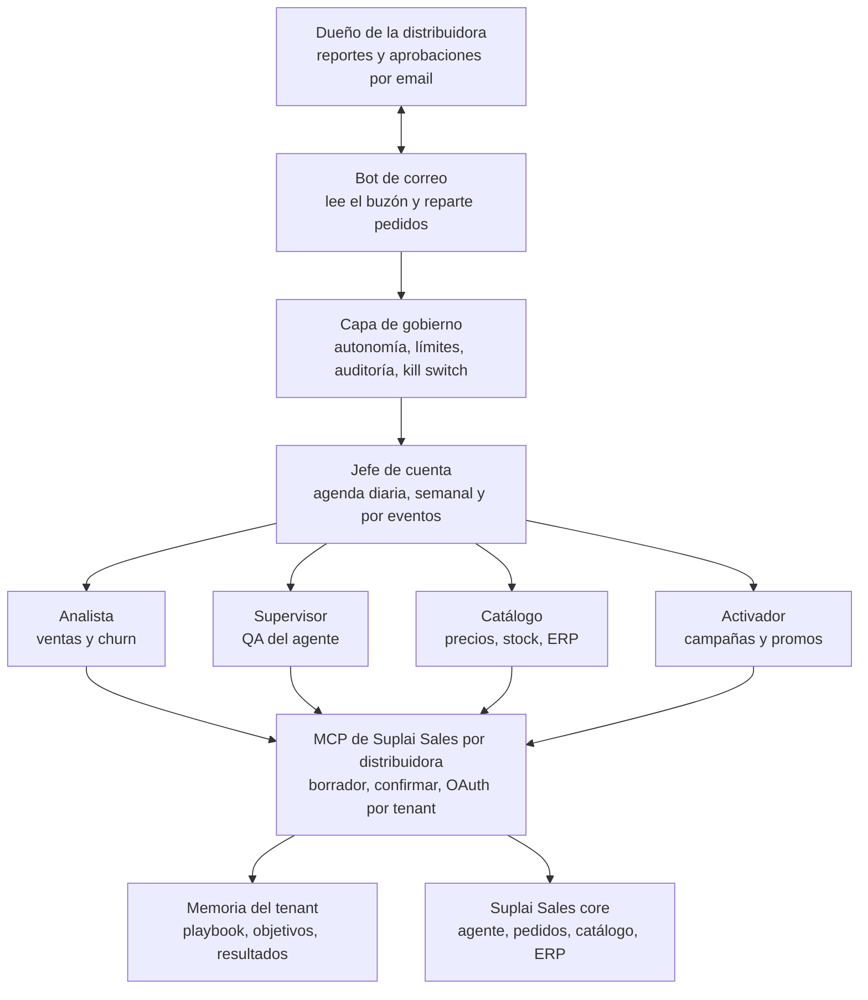

# 132 — MCP de Suplai Sales para agentes y humanos

**Estado:** Aprobado el diseño (24/10/2026). Pendiente de implementar.
**Fecha:** 2026-10-24
**Repos:** `backend-supabase` (`mcp_server/`, `services/mcp_*`, `services/oauth/`), `suplai-platform` (este spec).
**Relaciona:** [094](./094-claude-mcp-manual.md) (MCP manual), [038](./038-copilot-agentes-especialistas.md) (agentes especialistas en el Copilot), [116](./116-mcp-pedidos-crud.md) (pedidos), [117](./117-mcp-canal-erp-o-carga.md)–[123](./123-mcp-erp-gescom.md) (ERP), [126](./126-mcp-una-agenda.md) (una agenda).
**Supersede:** la superficie de 52 tools de `mcp_server/superficie.py`. Las specs 094–126 siguen valiendo para la lógica de servicios; cambian los nombres y la forma de las tools.

---

## Objetivo

Que el MCP de cada distribuidora lo use, sobre todo, un equipo de agentes que trabaja solo, y que una persona también lo pueda usar para preguntas sueltas.

Hoy el MCP está pensado para una persona que conversa con Claude: 52 tools con nombres distintos para lo mismo (`buscar`, `explorar`, `listar`, `consultar`, `traer`), escrituras con un nombre que no dice qué hacen (`previsualizar_*`) y una familia ERP aparte. Para un agente que llama cientos de veces por día, eso es ruido: elige mal la tool, pide de más y no sabe qué puede hacer sin preguntar.

Este spec define:

1. Quién usa el MCP y con qué permisos.
2. Una convención de nombres única y el catálogo nuevo (de 52 a 40 tools).
3. El contrato de lectura (campos y filtros en la firma, origen Suplai o ERP).
4. El contrato de escritura (borrador, riesgo, confirmar, lotes que aprueba el dueño por email).
5. El gobierno: autonomía, límites, auditoría y kill switch, aplicados en el servidor y no en el prompt.
6. La memoria del tenant y los eventos que despiertan a los agentes.
7. Cómo aprueba el dueño: por email, en un lote por semana.

---

## Quién usa el MCP

| Actor | Qué hace con el MCP | Volumen |
|---|---|---|
| **Bot de correo** | Lee el buzón de la distribuidora. Pasa los pedidos del dueño al jefe de cuenta, manda los reportes y lotes por email, y registra en el MCP lo que el dueño aprueba o rechaza. | Bajo, con escrituras de gobierno |
| **Jefe de cuenta** (orquestador) | Lee eventos, memoria y resultados. Arma la agenda, reparte trabajo, confirma lo que proponen los especialistas y arma el lote de la semana. | Alto |
| **Analista** | Ventas, churn, clientes en riesgo, rendimiento por zona y vendedor. Escribe resultados en la memoria. | Alto, solo lectura |
| **Supervisor** | Lee conversaciones, prueba el agente, diagnostica búsquedas, propone cambios al prompt y a los productos (alias, descripciones). | Medio, con escrituras de riesgo |
| **Catálogo** | Precios, stock, productos y promos. Compara con el ERP e importa. | Medio, con escrituras frecuentes |
| **Activador** | Plantillas, grupos, agendas, secuencias y promos. Mide envíos. | Medio, con escrituras que llegan a clientes |
| **Humano** (dueño, operador de Suplai) | Preguntas puntuales y ajustes a mano. El dueño aprueba por email, no desde el MCP. | Bajo |

El dueño no usa el MCP para aprobar: recibe un email y responde. Los PDFs y los emails los arman y mandan los bots; el MCP solo guarda el estado (borradores, lotes, aprobaciones) y lo hace cumplir.

El MCP es el único camino de los agentes hacia los datos y las acciones. Ningún agente toca la base ni la API del core por fuera del MCP: así el gobierno y la auditoría valen para todos.

---

## Principios de diseño

| Principio | Qué implica | Por qué |
|---|---|---|
| Agentes primero, humanos también | Respuestas estables en JSON con ids y totales, y un `resumen` corto en lenguaje natural para la persona. | El agente parsea; la persona lee. Una sola tool sirve a los dos. |
| Un verbo por tipo de acción | `buscar_*`, `ver_*`, `editar_*`, `confirmar`. | El modelo elige la tool por el verbo sin leer 52 descripciones. |
| Familias del modelo de negocio | Productos, clientes, pedidos, vendedores, zonas, WhatsApp, conversaciones, agente, notificaciones. | Son las entidades que entiende el dueño y que ya existen en el core. |
| El ERP es un origen, no una familia | Parámetro `origen` en las lecturas e `importar_erp` en las escrituras. | El agente no tiene que saber qué ERP tiene el tenant. |
| Nada se escribe sin `confirmar` | `editar_*` deja un borrador. | Es el patrón que ya funciona; se mantiene. |
| Las reglas viven en el servidor | Autonomía, límites y kill switch se validan en `confirmar`. | Un prompt se puede saltear; el servidor no. |
| Cada llamada dice quién y por qué | `agente` y `motivo` en las escrituras; quedan en la auditoría. | El dueño tiene que poder reconstruir qué hizo cada agente. |

---

## Convención de nombres

| Verbo | Uso | Reemplaza |
|---|---|---|
| `buscar_<familia>` | Varias filas con filtros (GET de una colección). | `buscar_*`, `explorar_*`, `listar_*`, `consultar_*`, `traer_*_erp`, `metricas_*` |
| `ver_<cosa>` | La ficha completa de una fila (GET de una). | `ver_*` |
| `editar_<familia>` | Alta, edición o baja con `accion`. Deja un borrador. | `previsualizar_*` |
| `confirmar` | Ejecuta un borrador. | Igual que hoy |

- `editar` y no `cargar`: la misma tool da de alta, edita y borra. `cargar` se lee como solo alta.
- Una familia se parte en una segunda tool `editar_*` solo cuando la entidad tiene otra clave o otro ciclo de vida (las promociones no son productos; las listas de precios tampoco).
- Toda respuesta de `editar_*` termina igual: «Borrador listo, no se guardó nada. Para aplicarlo, confirmar con `borrador_id`.»

---

## Catálogo de tools (40)

### Orientación y gobierno

| Tool | Qué hace |
|---|---|
| `guia_suplai` | Recetas por tema. Para el humano y para el arranque de un agente. |
| `confirmar` | Ejecuta un borrador si el gobierno lo permite; si necesita aprobación, lo deja pendiente para el lote. |
| `buscar_borradores` | Borradores del tenant con su estado (pendiente, en lote, aprobado, rechazado, vencido, aplicado), el agente que lo propuso y su lote. |
| `buscar_lotes` / `editar_lotes` | El lote que se le manda al dueño: la estrategia de la semana y los borradores que piden aprobación. `editar_lotes` arma, cierra y resuelve (ver «Aprobación por lotes»). |
| `editar_gobierno` | Pausar y reanudar (kill switch), y cambiar límites y autonomía. |
| `buscar_eventos` | Lo que pasó desde un cursor: pedido nuevo, sin stock, cliente en riesgo, envío fallido, reclamo en una charla, sync de ERP. |
| `ver_memoria` / `editar_memoria` | Playbook, objetivos y resultados del tenant. |
| `reportar_problema` | Reporte a soporte de Suplai. Reemplaza `previsualizar_reporte`, que se confundía con el reporte de ventas. |

### Productos

| Tool | Qué hace |
|---|---|
| `buscar_productos` | Ficha completa: stock, precio por lista, alias, categoría, tags, promos vigentes, estado en el ERP. Filtrable por casi todos los campos. |
| `ver_producto` | Un SKU con todo, incluido el historial de precio y stock. |
| `editar_productos` | `accion`: alta, editar (nombre, descripción, alias, stock, precio por lista, categoría, tag), ocultar, baja, `importar_erp`. Al confirmar un cambio de nombre, descripción o alias, re-vectoriza solo. |
| `buscar_listas` / `editar_listas` | `tipo`: listas de precios, categorías, tags. |
| `buscar_promociones` / `editar_promociones` | Promos y combos, con sus componentes y listas. |

### Clientes

| Tool | Qué hace |
|---|---|
| `buscar_clientes` | Filtros: zona, etiqueta, vendedor, lista de precios, estado de compra, WhatsApp, código. Une `buscar_clientes` y `explorar_clientes`. |
| `ver_cliente` | Ficha, últimos pedidos, conversación, etiquetas, zona y vendedor. |
| `editar_clientes` | Alta, edición, carga masiva, asignar lista, zona o vendedor. |
| `buscar_etiquetas` / `editar_etiquetas` | Etiquetas; `editar_etiquetas` también las asigna a clientes. Las etiquetas son filtro de `buscar_clientes`. |

### Pedidos

| Tool | Qué hace |
|---|---|
| `buscar_pedidos` | Pedidos y líneas, con `origen` Suplai o ERP en la capa de servicios. |
| `editar_pedidos` | Alta y baja con reglas de seguridad (ver «Escritura de pedidos»). |

### Vendedores y zonas

| Tool | Qué hace |
|---|---|
| `buscar_vendedores` | Con el id y el nombre de la zona asignada. |
| `editar_vendedores` | Alta, edición, baja, asignar zona. |
| `buscar_zonas` | Id, nombre, cantidad de clientes, vendedores y ventas del período. Reemplaza `listar_geozonas` y `mapa_zonas`. |
| `editar_zonas` | Alta, ajustar polígono, asignar clientes y vendedores, desactivar. Es la única forma de crear zonas: reemplaza `previsualizar_zona`. |

### WhatsApp

| Tool | Qué hace |
|---|---|
| `buscar_plantillas` / `editar_plantillas` | Plantillas con su estado en Meta y sus métricas de uso. |
| `buscar_envios` | Envíos con métricas (entregados, leídos, respondidos, pedidos generados), por fecha y con el id de la conversación que siguió. |
| `editar_envios` | `tipo`: agenda, grupo o secuencia. Las agendas mandan la variable producto: fija para todos (`dynamic_params`) o por cliente (sus productos más comprados). |

### Conversaciones

| Tool | Qué hace |
|---|---|
| `buscar_conversaciones` | Filtros: fecha, cliente, zona, etiqueta, con o sin pedido, con reclamo. `incluir_metricas` trae el resumen y el tablero. |
| `ver_conversacion` | El hilo completo con las tools que corrió el agente. |

### Agente

| Tool | Qué hace |
|---|---|
| `probar_agente` | Un turno del agente sin WhatsApp, con las tools que corrió (el lab de `/lab/mcp`). |
| `diagnosticar_busqueda` | Con frases, explica el ranking. Sin frases, diagnostica las búsquedas reales que no encontraron nada. Une `busquedas_sin_match`. |
| `ver_prompt` / `editar_prompt` | El prompt completo por secciones; `editar_prompt` reemplaza, agrega o quita secciones (ver «Edición del prompt»). |

### Notificaciones

| Tool | Qué hace |
|---|---|
| `buscar_notificaciones` | `tipo`: canal, pedido o envío. Para la distribuidora: vendedores y administrativos. |
| `editar_notificaciones` | Quién recibe qué aviso y por qué canal. |

Los reportes y aprobaciones del dueño van por email (ver «Aprobación por lotes»), no por estas tools.

---

## Contrato de lectura

Toda tool `buscar_*` acepta los mismos parámetros:

| Parámetro | Tipo | Qué hace |
|---|---|---|
| `campos` | lista cerrada | Columnas a devolver. Sin campos, devuelve un conjunto corto por defecto. |
| `filtros` | lista de `{campo, op, valor}` | `op` en `=`, `!=`, `<`, `<=`, `>`, `>=`, `contiene`, `en`, `entre`, `vacio`. |
| `orden` | `{campo, dir}` | Orden por un campo permitido. |
| `cursor` / `tamano` | texto / 1–200 | Paginación por cursor, estable entre llamadas. |
| `origen` | `suplai` · `erp` · `comparar` | Solo en productos, clientes y pedidos. `comparar` marca las diferencias. |

- Los campos y los operadores válidos son `enum` en el esquema JSON de la tool. El modelo los ve en la firma sin hacer una llamada previa: es el `SELECT *` de la idea, sin SQL.
- No hay SQL libre. La capa de servicios arma la consulta con los campos permitidos y el schema del tenant. Así no hay inyección ni lecturas de otro tenant.
- Respuesta: `{"filas": [...], "total": n, "cursor": "...", "resumen": "texto para la persona"}`.

---

## Contrato de escritura

### Borrador

`editar_*` valida, calcula el efecto y guarda un borrador. No cambia nada. La respuesta trae:

| Campo | Qué es |
|---|---|
| `borrador_id` | Lo que se pasa a `confirmar`. |
| `efecto` | Qué cambia: filas, antes y después, cantidad. |
| `riesgo` | `bajo`, `medio` o `alto`, según la acción y el tamaño (ver gobierno). |
| `avisos` | Lo que conviene saber antes de confirmar: duplicados, mezcla con datos del ERP, clientes sin lista. |
| `vence` | Los borradores vencen; uno vencido no se confirma. |

Toda escritura pide `agente` (quién) y `motivo` (por qué, en una frase). Para el humano los completa el servidor.

### Razonamiento

Los agentes de escritura también mandan `razonamiento`, para que el reporte al dueño muestre cómo pensaron y no solo qué hicieron:

| Campo | Qué es | Ejemplo |
|---|---|---|
| `observacion` | Qué vio en los datos. | «12 clientes de zona norte no compran hace 30 días; antes compraban cada 10.» |
| `evidencia` | Las consultas o ids que lo respaldan: tool, filtros y resultado. | `buscar_clientes(estado_compra=en_riesgo, zona=3)` → 12 filas |
| `hipotesis` | Por qué cree que pasa. | «La competencia bajó el precio de la yerba 1 kg.» |
| `propuesta` | Qué hace y por qué eso y no otra cosa. | «Combo yerba con 10 % a esos 12 clientes.» |
| `alternativas` | Qué descartó y por qué. | «Bajar el precio de lista: afecta a 400 clientes.» |
| `impacto_esperado` | Qué espera que cambie y cómo se va a medir. | «6 pedidos en 7 días; se mide con `buscar_pedidos`.» |
| `confianza` | `baja`, `media` o `alta`. | `media` |

- El MCP guarda el razonamiento con el borrador y lo devuelve en `buscar_borradores` y `buscar_lotes`. El lote junta los razonamientos de la semana con la estrategia del jefe de cuenta.
- Los bots arman con eso el email y el PDF: qué se propone, por qué, con qué datos, qué se descartó y qué se espera.
- Al cerrar la semana, el agente escribe en la memoria (`resultados`) qué pasó contra lo esperado. El reporte siguiente puede decir «la semana pasada esperábamos 6 pedidos y hubo 4».
- El razonamiento es obligatorio en lo que va a un lote y opcional en lo `auto`.

### Confirmar

`confirmar(borrador_id, clave_idempotencia)`:

1. Revisa el kill switch del tenant y del agente.
2. Revisa los límites (ver gobierno).
3. Si la autonomía de esa acción es `auto`, aplica. Si es `aprobar`, deja el borrador pendiente para el próximo lote y devuelve `estado: pendiente_aprobacion`, salvo que una estrategia ya aprobada lo cubra (ver «Aprobación por lotes»). Si es `prohibido`, rechaza.
4. Registra el resultado en la auditoría.

`clave_idempotencia` evita que un reintento del agente aplique dos veces.

### Quién confirma

- Cada especialista confirma sus borradores de autonomía `auto`.
- El jefe de cuenta confirma cualquier borrador de un especialista: es el orquestador. Los límites y la autonomía valen igual para él; lo que pide aprobación va al lote.
- El bot de correo no confirma borradores: solo resuelve lotes con la respuesta del dueño.

### Aprobación por lotes

El dueño recibe **un email por lote**, no uno por borrador.

1. Durante la semana, los borradores que piden aprobación quedan `pendiente_aprobacion`.
2. El jefe de cuenta arma el lote con `editar_lotes(accion="armar")`: la estrategia de la semana en texto, los borradores pendientes y, si quiere, un **presupuesto** (por ejemplo, «hasta 300 envíos de la campaña de turrones» o «cambios de precio de hasta 5 % en bebidas»).
3. Lo cierra con `editar_lotes(accion="cerrar")`. El bot de correo lo lee con `buscar_lotes`, arma el email (y el PDF, si hace falta) y se lo manda al dueño.
4. El dueño responde. Puede aprobar todo, rechazar todo o aprobar una parte.
5. El bot de correo registra la respuesta con `editar_lotes(accion="resolver", decision, borrador_ids, evidencia)`.
6. Los borradores aprobados se aplican. El presupuesto aprobado queda vigente hasta el fin de la semana: lo que entre en él se confirma sin volver a preguntar.

**Seguridad del canal:**

- Solo el token del bot de correo tiene el scope `aprobaciones:resolver`.
- Las direcciones que pueden aprobar están en `metadata.gobierno.aprobadores`. Un email de otra dirección, o que no pasa SPF y DKIM, no aprueba nada.
- `evidencia` guarda el id del mensaje y el remitente; queda en la auditoría.
- Un lote vence a los 7 días sin respuesta. Sus borradores vencen con él.

### Escritura de pedidos

- Deduplica por número de comprobante y cliente: un pedido que ya existe no se carga de nuevo.
- Si el tenant tiene ERP conectado, el borrador avisa que mezclar pedidos cargados a mano con los del ERP es peligroso, y `confirmar` exige `forzar_mezcla_erp`.
- La baja es lógica (`deleted_at`) y solo para pedidos cargados por el MCP que no se enviaron al ERP. Riesgo `alto` siempre.

### Edición del prompt

- `editar_prompt` opera sobre secciones con nombre: `reemplazar`, `agregar`, `quitar`.
- El borrador muestra el diff completo.
- Se rechaza si falta una sección obligatoria o si se borra más del 30 % del texto.
- Riesgo `alto` siempre: lo aprueba el dueño o un operador de Suplai.
- Segunda etapa: un chequeo de contradicciones entre la sección nueva y las demás.

---

## Gobierno

Vive en el servidor del MCP y se configura por tenant en `metadata.gobierno` de `public.distribuidoras`.

### Roles y permisos

Cada agente tiene su token OAuth por tenant con un paquete de scopes. Los scopes son los de hoy (`services/oauth/constants.py`), agrupados por rol:

| Rol | Lee | Escribe |
|---|---|---|
| Bot de correo | lotes, borradores, gobierno | resolver lotes, pausar y reanudar |
| Jefe de cuenta | todo | memoria, lotes, confirmar borradores de los especialistas |
| Analista | pedidos, productos, clientes, conversaciones, vendedores, zonas, eventos | memoria (resultados) |
| Supervisor | conversaciones, productos, prompt | productos (alias, descripción), prompt, búsqueda |
| Catálogo | productos, promos, listas, ERP | productos, promos, listas |
| Activador | clientes, etiquetas, plantillas, envíos, promos | plantillas, envíos, etiquetas, promos |
| Humano | según sus scopes | según sus scopes |

Un agente no ve las tools que su token no alcanza (igual que hoy con `filtrar_visibles`).

### Autonomía por acción

| Acción | Default |
|---|---|
| Lecturas | `auto` |
| Memoria, alias, descripciones | `auto` |
| Stock, precios hasta el límite, etiquetas, grupos | `auto` |
| Envíos a clientes, plantillas nuevas, promos | `aprobar` |
| Precios por encima del límite, bajas de productos, prompt | `aprobar` |
| Baja de pedidos, mezcla con ERP | `aprobar` |

El dueño cambia los defaults desde el admin o pidiéndolo por email. Un operador de Suplai con el scope puede aprobar a mano en una emergencia; queda auditado igual.

### Límites

Ejemplos de límites por tenant, validados en `confirmar`:

- `max_envios_dia`: clientes alcanzados por WhatsApp por día.
- `max_cambio_precio_pct`: cambio de precio por SKU sin aprobación.
- `max_bajas_productos`: bajas por borrador.
- `max_escrituras_hora`: por agente, para cortar un loop.

### Auditoría

Cada llamada queda en `public.mcp_auditoria` con agente, motivo, borrador, riesgo y quién aprobó. El dueño recibe por email un reporte de lo que hizo cada agente, lo que quedó pendiente y lo que se rechazó; lo arman y lo mandan los bots.

### Kill switch

- `gobierno.pausado` frena todas las escrituras del tenant.
- `gobierno.agentes_pausados` frena las de un agente.
- Las lecturas siguen andando, para poder diagnosticar.
- Lo activa el dueño por email («pausar agentes»: el bot de correo llama a `editar_gobierno`) o desde el admin. Pausar no espera lote: es inmediato.

---

## Memoria del tenant y eventos

**Memoria** (`ver_memoria`, `editar_memoria`):

| Parte | Qué guarda | Quién la escribe |
|---|---|---|
| Playbook | Cómo trabaja esta distribuidora: horarios, tono, reglas comerciales, qué no hacer. | Humano; los agentes proponen y el dueño aprueba. |
| Objetivos | Metas del período: ventas, reactivación, cobertura por zona. | Humano y jefe de cuenta |
| Resultados | Qué se hizo y qué dio: campañas, cambios de precio, pruebas del agente. | Cada agente al terminar una tarea |

**Eventos** (`buscar_eventos`): cola por tenant con cursor, para que el jefe de cuenta no tenga que recorrer todo. Tipos iniciales: `pedido_nuevo`, `pedido_error_erp`, `sin_stock`, `cliente_en_riesgo`, `envio_fallido`, `reclamo_en_charla`, `sync_erp`, `borrador_aprobado`, `borrador_rechazado`, `lote_resuelto`, `pedido_del_dueno` (lo que el dueño pide por email, para que el jefe de cuenta lo agende).

---

## Respuestas para agentes y para humanos

- Siempre JSON con la misma forma por verbo, ids reales y totales.
- `resumen`: dos o tres líneas para la persona; el agente lo puede ignorar.
- Errores con `codigo` estable (`campo_invalido`, `sin_permiso`, `limite_excedido`, `pausado`, `borrador_vencido`), el campo que falló y qué hacer.
- Las tools con interfaz (`ui_apps.py`, mapas, paneles) se mantienen para el humano y no son necesarias para el agente.

---

## Migración de las 52 tools

| Hoy | Pasa a |
|---|---|
| `consultar_pedidos` | `buscar_pedidos` |
| `previsualizar_carga_pedidos` | `editar_pedidos` |
| `explorar_productos`, `previsualizar_stock`, `previsualizar_precios` | `buscar_productos`, `editar_productos` |
| `previsualizar_correccion`, `previsualizar_ocultar_producto`, `previsualizar_aliases` | `editar_productos` |
| `listar_catalogo` | `buscar_listas`, `buscar_promociones` |
| `previsualizar_lista_precios`, `previsualizar_categoria`, `previsualizar_tag_producto` | `editar_listas` |
| `previsualizar_promocion` | `editar_promociones` |
| `previsualizar_carga` | `editar_productos` y `editar_clientes` (hoy mezcla los dos) |
| `buscar_clientes`, `explorar_clientes` | `buscar_clientes` |
| `previsualizar_lista_clientes` | `editar_clientes` |
| `listar_etiquetas`, `previsualizar_etiqueta` | `buscar_etiquetas`, `editar_etiquetas` |
| `listar_conversaciones`, `metricas_conversaciones` | `buscar_conversaciones` |
| `ver_conversacion` | `ver_conversacion` |
| `listar_plantillas`, `metricas_whatsapp`, `previsualizar_plantilla` | `buscar_plantillas`, `editar_plantillas` |
| `listar_envios` | `buscar_envios` |
| `previsualizar_agenda`, `previsualizar_grupo`, `previsualizar_secuencia` | `editar_envios` |
| `listar_geozonas`, `mapa_zonas` | `buscar_zonas` |
| `previsualizar_zona` | `editar_zonas` |
| `listar_vendedores`, `previsualizar_vendedor` | `buscar_vendedores`, `editar_vendedores` |
| `ver_notificaciones`, `ver_notificaciones_pedido`, `ver_envios_notificacion`, `previsualizar_notificaciones` | `buscar_notificaciones`, `editar_notificaciones` |
| `busquedas_sin_match`, `diagnosticar_busqueda` | `diagnosticar_busqueda` |
| `ver_seccion_prompt`, `previsualizar_seccion_prompt` | `ver_prompt`, `editar_prompt` |
| `probar_agente` | `probar_agente` |
| `traer_clientes_erp`, `traer_productos_erp`, `traer_precios_erp`, `traer_promociones_erp` | `origen="erp"` en `buscar_*`; `importar_erp` en `editar_productos` |
| `previsualizar_reporte` | `reportar_problema` |
| `guia_suplai`, `confirmar` | Igual |

Sin convivencia: el MCP nuevo reemplaza al viejo en un solo despliegue. Los nombres viejos no quedan como alias.

---

## Etapas

Todo se desarrolla en una rama del backend y sale en **un solo despliegue**: el MCP nuevo reemplaza al viejo, sin convivencia.

| Etapa | Qué | Listo cuando |
|---|---|---|
| 1. Lectura | Los `buscar_*` con `campos`, `filtros`, `orden`, `cursor` y `origen`. `ver_*`. | Toda consulta de hoy sale con las tools nuevas. |
| 2. Escritura | `editar_*`, borrador con riesgo, `confirmar` con idempotencia. Pedidos seguros. Re-vectorizado al editar productos. | Todo borrador de hoy anda con los nombres nuevos. |
| 3. Gobierno | Autonomía, límites, kill switch (`editar_gobierno`), lotes con presupuesto (`buscar_lotes`, `editar_lotes`), auditoría con agente, motivo y evidencia. | Un agente no pasa un límite ni escribe con el tenant pausado; un lote se resuelve con la respuesta del dueño. |
| 4. Agentes | Tokens por rol (incluido el bot de correo), `buscar_eventos`, memoria del tenant. Evals por rol. | El jefe de cuenta corre una semana en un tenant de prueba: arma el lote, el dueño lo aprueba por email y se aplica. |
| 5. Corte | Borrar las 52 tools viejas, actualizar guías, scopes y evals, desplegar. | Evals verdes solo con las 40. |

Arcor primero: las etapas 1 a 3 se prueban con almaro y gonzales.

---

## Base de datos

**Aprobado por Facundo el 24/10/2026:** tablas propias para este enfoque. Se crean con migraciones en `backend-supabase/sql/`.

| Tabla | Qué guarda |
|---|---|
| `core.mcp_borradores` | Cada borrador: tenant, tool, acción, efecto, riesgo, agente, motivo, razonamiento, estado, lote, vencimiento, clave de idempotencia. |
| `core.mcp_lotes` | Cada lote: tenant, semana, estrategia en texto, presupuesto, estado, quién resolvió, evidencia del email. |
| `core.mcp_eventos` | La cola de eventos por tenant, con cursor. |
| `core.tenant_memoria` | Playbook, objetivos y resultados por tenant, con autor y fecha. |

La configuración de gobierno (autonomía, límites, aprobadores, pausa) va en `public.distribuidoras.metadata.gobierno`, que ya es JSON.

**Pendiente de confirmar al implementar la etapa 3:** columnas nuevas en `public.mcp_auditoria` (agente, motivo, borrador, riesgo, aprobación). La alternativa es guardarlas en `parametros` (JSON), que es menos consultable.

---

## Fuera de alcance

- Los agentes en sí (prompts, agenda del jefe de cuenta, cómo corren). Este spec es la superficie que usan.
- El buzón de email, los PDFs y el envío de reportes: los hacen los bots. El MCP guarda el estado de borradores y lotes y lo hace cumplir.
- SQL libre o NL→SQL desde el MCP.
- Agentes creados por el tenant: los roles son producto de Suplai, como en 038.

---

## Decisiones tomadas

| Tema | Decisión |
|---|---|
| Canal del dueño | Email. Recibe reportes y lotes, y aprueba respondiendo. Un bot de correo lee el buzón y reparte los pedidos. |
| Aprobación | Un email por lote. El dueño puede aprobar la estrategia de toda la semana, con un presupuesto que cubre lo que venga dentro de él. |
| Jefe de cuenta | Confirma lo que proponen los especialistas: es el orquestador. Los límites valen igual para él. |
| Almacenamiento | Tablas propias para borradores, lotes, eventos y memoria. |
| Nombres viejos | No conviven. El MCP nuevo reemplaza al viejo en un solo despliegue. |

---

## Plan de prueba

**CI** (`mcp_server/evals`):

- Una eval por rol con su token: el agente ve solo sus tools, elige la tool correcta por el verbo y no pasa los límites.
- Contrato: todo `buscar_*` acepta los mismos parámetros, todo `editar_*` devuelve borrador con riesgo, `confirmar` respeta idempotencia, kill switch y límites.
- Lotes: un borrador `aprobar` queda pendiente; al resolver el lote se aplica; lo que entra en el presupuesto aprobado se confirma sin volver a preguntar; un lote vencido no aprueba nada.
- Seguridad: `editar_lotes(accion="resolver")` sin el scope `aprobaciones:resolver`, o con un remitente que no está en `aprobadores`, se rechaza.
- Migración: cada caso de las evals actuales tiene su equivalente con las tools nuevas.

**Prueba humana:**

1. Un humano pregunta «¿qué vendió la zona norte este mes?» y lo resuelve en una llamada.
2. El Activador arma un envío a 500 clientes con un límite de 300: el borrador queda pendiente y entra en el lote.
3. El jefe de cuenta cierra el lote con la estrategia de la semana; el dueño recibe el email, aprueba todo respondiendo, y los borradores se aplican.
4. El dueño manda «pausar agentes» por email: las escrituras se frenan en el momento y las lecturas siguen.
5. El Catálogo compara precios con `origen="comparar"` e importa los que difieren: queda auditado con agente y motivo.
