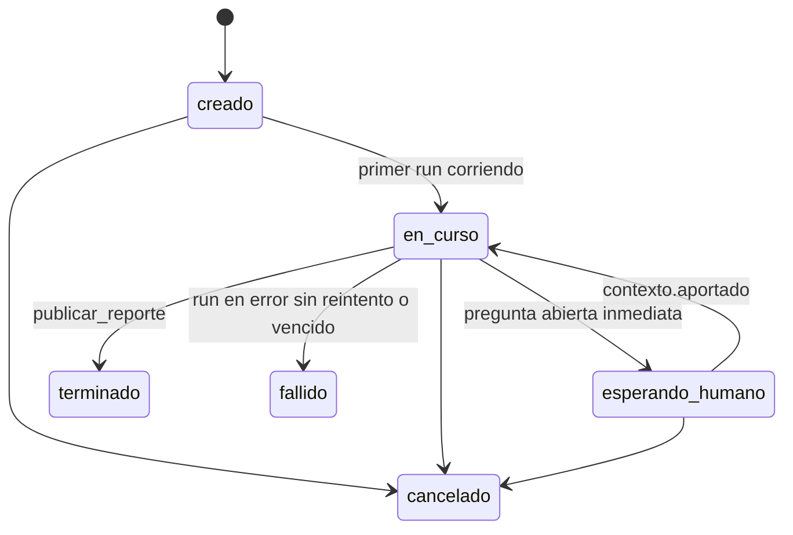

# 136 — Equipo de agentes: modelo de datos

**Estado:** Borrador. Las tablas nuevas necesitan aprobación explícita antes de migrar (regla de cambios de esquema en la base compartida).
**Fecha:** 2026-10-27
**Repos:** `backend-supabase` (`sql/`, `data_access/agentes_*`, `services/agentes_*`).
**Rama sugerida:** `feat/agentes-modelo-datos`.
**Relaciona:** [134](./134-mvp-equipo-de-agentes.md), [132](./132-mcp-para-agentes-y-humanos.md) (`core.mcp_borradores`, `core.mcp_eventos`, `core.tenant_memoria`), [125](./125-notificaciones-cola-canales.md) (`notification_jobs`).

---

## Objetivo

Guardar los trabajos, sus runs, su traza, el circuito con el humano (preguntas, contexto, propuestas), los reportes, los bots con su certificado versionado y los avisos. Diez entidades, todas aisladas por tenant.

### Criterios de aceptación

- Cada fila de cada tabla tiene `distribuidora_id` y `schema_name`, y todo acceso desde `data_access/` filtra por ellos.
- Un bot no puede leer ni escribir filas de otro tenant aunque conozca el id: la consulta siempre lleva el tenant del token.
- Editar un certificado inserta una versión nueva. No existe `UPDATE` sobre el contenido de una versión.
- Un Trabajo no se puede crear sin humano asignado ni sin al menos un bot delegado.
- Las Propuestas son borradores del 132; no hay una segunda tabla de propuestas.
- Cada tabla nueva tiene su rollback escrito en la migración.

---

## Dónde viven

| Decisión | Elección | Por qué | Alternativa descartada |
|----------|----------|---------|------------------------|
| Schema | `core.agentes_*`, con `distribuidora_id` y `schema_name` en cada fila | Es el patrón de 174–177 (borradores, lotes, eventos, memoria). Una migración sirve para todos los tenants y el backoffice agéntico cruza tablas sin `search_path` dinámico | Tablas dentro de cada schema de tenant: una migración por tenant y joins con `core.mcp_borradores` entre schemas |
| Aislamiento | Filtro obligatorio en `data_access/agentes_*` + chequeo en el servicio de que el token y la fila son del mismo tenant | Igual que hoy en el MCP. Los bots nunca tocan SQL (principio 1 del 132) | RLS de Postgres: el backend usa el rol de servicio, RLS no lo frena |
| Propuesta | Columnas nuevas en `core.mcp_borradores` | El borrador ya tiene efecto, riesgo, motivo, razonamiento e idempotencia | Tabla `propuestas` que duplica el borrador |
| Aviso y envío | `core.agentes_avisos` guarda el qué y el por qué; el envío va por `notification_jobs` del 125 | La cola ya reintenta y registra entregas | Mandar Brevo desde el servicio de agentes |
| Archivos | Columnas con path del bucket, nunca la URL firmada | Las URLs firmadas vencen | Guardar la URL |

El documento de producto dice «todas viven dentro del tenant». Se cumple por la clave de tenant en cada fila, no por el schema físico. Si el review prefiere schema por tenant, cambia solo `data_access/`.

---

## Entidades

### `core.agentes_bots`

| Columna | Tipo | Notas |
|---------|------|-------|
| `id` | uuid PK | |
| `distribuidora_id`, `schema_name` | uuid, text | |
| `nombre` | text | «Jefe de cuenta». Editable |
| `rol` | text | `jefe_de_cuenta`, `analista_ventas`, `analista_conversaciones`, `activador`. Check con la lista |
| `estado` | text | `activo` o `pausado` |
| `modelo` | text | Modelo del bot en Vertex, por ejemplo `claude-sonnet-5-5` |
| `certificado_id` | uuid | Versión vigente. FK a `agentes_certificados` |
| `created_at`, `updated_at` | timestamptz | |

Único: `(distribuidora_id, rol)`. Un rol, un bot por tenant en el MVP.

### `core.agentes_certificados`

| Columna | Tipo | Notas |
|---------|------|-------|
| `id` | uuid PK | |
| `bot_id` | uuid FK | |
| `distribuidora_id`, `schema_name` | | |
| `version` | int | Empieza en 1. Único `(bot_id, version)` |
| `que_hace` | text | Descripción para el humano |
| `fuentes` | text[] | Familias de datos: `pedidos`, `clientes`, `productos`, `zonas`, `conversaciones`, `busquedas`, `metricas`, `memoria`, `promociones` |
| `niveles` | jsonb | `{"<tarea>": "L1".."L5"}`. Tareas por rol en [140](./140-agentes-bots-mvp.md) |
| `reglas` | jsonb | Lista de `{texto, origen}`; `origen` puede ser un `contexto_id` promovido |
| `editado_por` | uuid | Usuario del backoffice. La versión 1 la crea el sistema (`null`) |
| `motivo` | text NOT NULL | |
| `created_at` | timestamptz | |

Sin `updated_at`: las filas son inmutables. La migración revoca `UPDATE` y `DELETE` sobre esta tabla al rol de la app.

### Niveles de autonomía

Propuesta de mapeo a la autonomía del 132. Se confirma contra el documento «Relación entre agentes y humanos» antes de migrar.

| Nivel | Qué puede el bot | En `confirmar` |
|-------|------------------|----------------|
| L1 | No hace la tarea | `prohibido`. La tool ni se expone |
| L2 | Sugiere en la traza, no arma borrador | `prohibido`; el bot usa `registrar_traza` con tipo `hallazgo` |
| L3 | Propone y espera al humano | `aprobar`: queda Propuesta |
| L4 | Hace y avisa | `auto` + Aviso en la banda configurada |
| L5 | Hace solo | `auto`, queda en la traza |

El certificado manda sobre `metadata.gobierno.autonomia`. Los límites del tenant (`max_*` del 132) y el kill switch valen igual por encima del certificado.

### `core.agentes_trabajos`

| Columna | Tipo | Notas |
|---------|------|-------|
| `id` | uuid PK | |
| `distribuidora_id`, `schema_name` | | |
| `pedido` | text | Lo que pidió el humano, literal |
| `tipo` | text | `analisis_ventas`, `analisis_conversaciones`, `activacion` (siguiente fase) |
| `parametros` | jsonb | Período y filtros que interpretó `encargar_analisis` |
| `humano_id` | uuid NOT NULL | Usuario asignado |
| `origen` | text | `claude`, `backoffice` o `agenda` |
| `estado` | text | `creado`, `en_curso`, `esperando_humano`, `terminado`, `cancelado`, `fallido` |
| `reporte_id` | uuid | |
| `clave_idempotencia` | text | Único por tenant. Evita duplicar un encargo por reintento de Claude |
| `created_at`, `terminado_at`, `updated_at` | timestamptz | |

### `core.agentes_trabajo_bots`

Los bots delegados. `(trabajo_id, bot_id)` PK, `rol_en_trabajo` (`responsable` o `colaborador`), `sumado_at`. Un check de aplicación exige al menos una fila al crear el trabajo (se crean en la misma transacción).

### `core.agentes_runs`

| Columna | Tipo | Notas |
|---------|------|-------|
| `id` | uuid PK | |
| `trabajo_id`, `bot_id` | uuid FK | |
| `distribuidora_id`, `schema_name` | | |
| `runtime` | text | `gcp_cloud_run` o `fake` |
| `id_externo` | text | Nombre de la ejecución del Cloud Run job. Único `(runtime, id_externo)` |
| `disparado_por` | text | Tipo de evento que lo lanzó |
| `estado` | text | `lanzando`, `corriendo`, `terminado`, `error`, `cancelado`, `vencido` |
| `inicio`, `fin` | timestamptz | |
| `consumo_estimado` | jsonb | `{tokens_in, tokens_out, usd}` si el runtime lo informa |
| `fin_recibido_at` | timestamptz | Cuándo llegó el aviso de fin firmado; un segundo aviso no hace nada ([137](./137-agentes-eventos-webhooks-scheduler.md)) |
| `resumen_runtime` | text | Lo que devuelve el runtime al terminar |

### `core.agentes_traza`

| Columna | Tipo | Notas |
|---------|------|-------|
| `id` | bigserial PK | Orden estable para el stream |
| `trabajo_id` | uuid FK | |
| `distribuidora_id`, `schema_name` | | |
| `actor_tipo` | text | `bot` o `humano` |
| `actor_id` | uuid | `bot_id` o `usuario_id` |
| `run_id` | uuid | Null para el humano |
| `tipo` | text | `plan`, `paso`, `hallazgo`, `pregunta`, `error`, `fin` |
| `estado` | text | `pensando`, `ejecutando`, `esperando`, `terminado` |
| `linea` | text NOT NULL | Una línea en lenguaje humano, hasta 280 caracteres |
| `inicio`, `fin` | timestamptz | |
| `datos_path` | text | Path en el bucket del tenant |
| `padre_id` | bigint | Para cerrar un paso: el evento `terminado` apunta al que abrió |
| `datos` | jsonb | Para `plan`: `{"pasos": [{"id","bot","linea"}]}` |
| `clave` | text | Única por trabajo; el reintento de una tool no duplica el paso |

Índice `(trabajo_id, id)`.

### `core.agentes_preguntas`

`id`, tenant, `trabajo_id`, `bot_id`, `traza_id`, `texto`, `banda` (`inmediato`, `lote_diario`, `resumen_semanal`), `estado` (`abierta`, `respondida`, `vencida`, `cancelada`), `respuesta`, `respondida_por`, `respondida_at`, `created_at`.

### `core.agentes_contexto`

`id`, tenant, `autor_id`, `texto`, `trabajo_id` (nullable), `pregunta_id` (nullable), `alcance` (`nota` o `candidato_regla`), `estado_regla` (`null`, `propuesta`, `aceptada`, `descartada`), `created_at`. Un contexto `candidato_regla` lo puede proponer el jefe de cuenta como edición del playbook en `core.tenant_memoria` (queda Propuesta L3).

### Propuesta: columnas nuevas en `core.mcp_borradores`

| Columna | Tipo | Notas |
|---------|------|-------|
| `trabajo_id` | uuid | Null para los borradores que no vienen de un trabajo |
| `bot_id` | uuid | |
| `decision_motivo` | text | Motivo del humano al aprobar o rechazar |
| `decidido_por` | uuid | |
| `decidido_at` | timestamptz | |
| `canal_decision` | text | `bandeja`, `lote_email` o `operador` |

La Propuesta es el borrador en `pendiente_aprobacion` con `bot_id` presente. La acción pedida es `tool` + `accion` + `efecto`; el motivo del bot es `motivo` + `razonamiento`.

### `core.agentes_reportes`

`id`, tenant, `trabajo_id`, `titulo`, `resumen`, `web_path`, `pdf_path`, `datos_path`, `anexo_traza` (jsonb: pasos clave y contexto aportado), `version` (si se republica), `created_at`.

### `core.agentes_avisos`

| Columna | Tipo | Notas |
|---------|------|-------|
| `id` | uuid PK | |
| tenant | | |
| `destinatario_id` | uuid | Usuario |
| `origen_tipo`, `origen_id` | text, text | `pregunta`, `propuesta`, `reporte`, `trabajo` |
| `motivo` | text | Por qué se avisa, en una línea |
| `canal` | text | `email` en el MVP |
| `banda` | text | |
| `notification_job_id` | bigint | El trabajo de envío del 125 |
| `enviado_at`, `leido_at` | timestamptz | `leido_at` por pixel o por click del link |
| `respuesta` | text | Si respondió desde el link |

Las preferencias de banda van en `metadata.agentes.avisos` de `public.distribuidoras` (JSON, por tipo de aviso).

---

## Estados del Trabajo

Las transiciones las hace solo `services/agentes_trabajos.py`. Ninguna tool cambia el estado directo.

---

## Migraciones

Una migración por bloque, con el número libre siguiente de `backend-supabase/sql/` al momento de mergear:

1. `agentes_bots_certificados.sql`: bots, certificados, revoke de `UPDATE`/`DELETE`.
2. `agentes_trabajos_traza.sql`: trabajos, trabajo_bots, runs, traza.
3. `agentes_circuito_humano.sql`: preguntas, contexto, columnas en `core.mcp_borradores`.
4. `agentes_reportes_avisos.sql`: reportes, avisos.
5. Seed por tenant (script, no migración): `scripts/agentes_alta_tenant.py --schema cordoba_frost` crea los tres bots con su certificado v1 de [140](./140-agentes-bots-mvp.md).

Rollback: dropear en orden inverso y quitar las columnas de `core.mcp_borradores`. Ninguna tabla existente pierde datos.

---

## Retención

La traza y los runs se guardan sin vencimiento en el MVP. Los archivos del bucket por trabajo, 180 días (ver [141](./141-agentes-reportes.md)).

## Plan de prueba

- Tests de `data_access`: toda función recibe tenant y una consulta con id de otro tenant devuelve vacío.
- Certificado: insertar v2 deja v1 intacta; un `UPDATE` directo falla por permisos.
- Trabajo sin bots falla en la transacción.
- Idempotencia: el mismo `clave_idempotencia` devuelve el trabajo existente.
