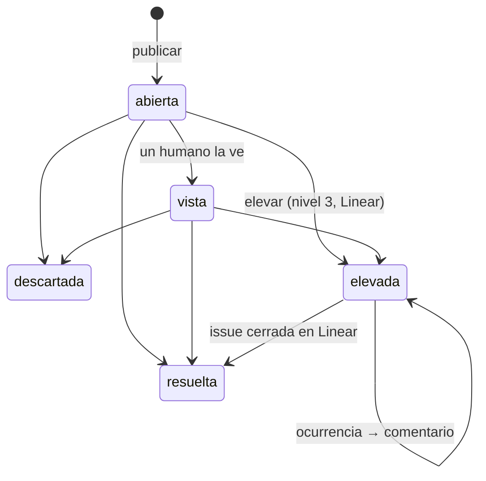

# 143 — Bandeja de notificaciones

**Estado:** Borrador. El modelo y el flujo están para revisar. Tres decisiones son de Faka y están abajo como «Decisión abierta»: el nombre ([DEV-56](https://linear.app/suplai-sales/issue/DEV-56)), la autorización del modo admin ([DEV-57](https://linear.app/suplai-sales/issue/DEV-57)) y qué es grave ([DEV-19](https://linear.app/suplai-sales/issue/DEV-19)).  
**Fecha:** 2026-10-30  
**Repos:** `backend-supabase` (modelo, servicio, endpoint interno, elevación a Linear, tools, productores), `agente-conversacional-multi_tenant` (modo admin y botón de la plantilla), `suplai-sales-claude-plugin` (skill y manual), `suplai-platform` (este spec).  
**Rama sugerida:** `feat/dev-58-bandeja-notificaciones`  
**Linear:** proyecto «Nivel 3 · Escalamiento a Faka». Este spec es [DEV-55](https://linear.app/suplai-sales/issue/DEV-55). Lo implementan DEV-58 a DEV-68.  
**Relaciona:** [125](./125-notificaciones-cola-canales.md) (cola, suscripciones y envíos), [134](./134-mvp-equipo-de-agentes.md) (equipo de agentes), [136](./136-agentes-modelo-de-datos.md) (trabajos, propuestas, `core.agentes_avisos`), [137](./137-agentes-eventos-webhooks-scheduler.md) (outbox y agendas), [139](./139-agentes-tools-mcp.md) (tools de los bots), [141](./141-agentes-reportes.md) (correo de reporte), [142](./142-agentes-prueba-cordoba-frost.md) (prueba en Córdoba Frost).

---

## Objetivo

Que lo que necesita la atención de alguien quede guardado como una fila con dueño, hasta que alguien lo resuelva, lo descarte o lo eleve. Hoy lo que falla se avisa y se pierde: un WhatsApp, un mail o una línea de log. Nadie sabe qué sigue pendiente.

La bandeja va arriba de la cola de la spec 125. La 125 resuelve **cómo llega** un aviso: quién está suscripto, por qué canal, con qué reintento. La bandeja guarda **qué queda pendiente**. La 125 pasa a ser el mecanismo que dice «Tenés N pendientes».

Tres niveles, del Customer Success escalonado:

| Nivel | Quién lo resuelve | Ejemplo |
|---|---|---|
| 1 | La distribuidora | Un cliente pidió hablar con alguien. Meta rechazó un envío por falta de pago |
| 2 | El equipo de agentes | Una incidencia de ERP que un bot puede revisar antes que un humano |
| 3 | Faka (Suplai) | Una tool del MCP tira una excepción. El sync de un ERP se cae por un error nuestro |

### Criterios de aceptación

- Publicar dos veces la misma clave, mientras la primera sigue activa, deja una sola notificación con `ocurrencias = 2`. No se crea otra fila.
- Publicar una clave cuya notificación ya está resuelta o descartada crea una fila nueva.
- Cada notificación tiene estado, nivel, origen, severidad, clave, contexto e historial. Cada cambio de estado deja una acción en el historial con el canal (`mcp`, `whatsapp`, `mail`, `agente`, `linear`, `sistema`) y quién la hizo.
- Una notificación de nivel 1 que corresponde avisar encola un trabajo `notificaciones_pendientes` en la cola de la 125. Diez notificaciones normales en una hora generan un solo WhatsApp y un solo mail por destino suscripto. Una crítica sale sola, en el momento.
- Desde Claude, un usuario de la distribuidora ve los pendientes agrupados por severidad y resuelve, descarta o eleva con borrador y `confirmar`.
- Desde WhatsApp, el botón **Ver notificaciones** pone al agente en modo admin. El agente resume los pendientes y deja resolver o elevar con botones. El usuario puede volver a modo cliente.
- Elevar a nivel 3 crea una issue en el proyecto «Nivel 3 · Escalamiento a Faka». Si ya hay una issue abierta para esa clave, suma un comentario. Cerrar la issue en Linear resuelve la notificación.
- La issue no lleva teléfonos, mails, nombres de clientes ni tokens.
- Los errores del MCP siguen escalando igual que con la versión directa de DEV-65: una issue por huella, comentario por ocurrencia, y los `AccionError` no escalan.

---

## Cómo está hoy

**Cola de avisos (125).** `public.notification_jobs`, `public.notification_deliveries` y `public.notification_subscriptions` existen en Suplai-east. `notification_jobs.event_type` no tiene check: un tipo nuevo no pide migración en esa tabla. La lista de tipos válidos vive en código, `EVENTOS` de `services/notificaciones_reglas.py` (`order_confirmed`, `asistencia_humana`, `error_sistema`). El worker es `services/notificaciones_worker.py` y el acceso a datos `data_access/notificaciones.py`. Las tools del conector que operan sobre suscripciones se llaman hoy `buscar_notificaciones` y `editar_notificaciones`.

**Incidencias de ERP.** `core.erp_incidencias` ya tiene su propio ciclo: `severidad` (`critica`, `alta`, `normal`), `estado` (`abierta`, `en_revision`, `propuesta`, `resuelta`, `ignorada`, `escalada`), `veces`, `primera_vez` y `ultima_vez`. Al 30/10 hay 1684 abiertas de severidad `normal`, 69 `alta` abiertas y una `critica` escalada. Si la bandeja copiara todas, nadie la leería.

**Jobs.** `core.jobs` (colas `erp:alta`, `erp:sync`, `erp:bulk`, `sistema`) termina en `dead` cuando agota intentos. Hoy un `dead` solo se ve consultando la tabla.

**Asistencia humana.** El agente crea un `{schema}.ia_tickets` y el observer encola `asistencia_humana` en la 125. El ticket se cierra con `status` y `closed_at`. Nadie más sabe si quedó abierto.

**Equipo de agentes (134/136).** En `main` existen `core.agentes_trabajos`, `core.agentes_runs` y `core.agentes_traza`. `core.agentes_avisos` está en el 136 pero todavía no está creada. La «Bandeja» del backoffice agéntico (spec 135) lista Preguntas y Propuestas (`core.mcp_borradores` en `pendiente_aprobacion` con `bot_id`), y su decisión se guarda con `canal_decision = bandeja`.

**Errores del MCP.** Cuando una tool falla, el conector sugiere `reportar_problema`, que termina en `submit_feedback` (`services/mcp_operacion.py`). Depende de que alguien lo pida. DEV-65 corre en paralelo con una versión directa que crea la issue en Linear por huella.

**Linear.** El backend no tiene cliente de Linear ni webhook de Linear.

---

## Decisiones de diseño técnico

| Decisión | Elección | Por qué | Alternativa descartada |
|---|---|---|---|
| Relación con la 125 | La bandeja guarda el pendiente. Para avisar, encola un tipo nuevo en la 125: `notificaciones_pendientes` | La cola ya reintenta, registra entregas y sabe quién está suscripto. La bandeja no manda nada por su cuenta | Un envío propio desde la bandeja, o meter el estado del pendiente en `notification_jobs` |
| Dónde vive | `core.notificaciones` y `core.notificaciones_acciones`, con `distribuidora_id` y `schema_name` en cada fila | Mismo patrón que `core.mcp_borradores`, `core.erp_incidencias` y `core.agentes_*`. Una migración vale para todos los tenants. Nivel 3 se lista sin cruzar schemas | Una tabla por schema de tenant |
| Notificación sin tenant | `schema_name` null solo con nivel 3 | Un error de plataforma (el MCP entero, el worker) no es de ninguna distribuidora | Inventar un tenant `suplai` |
| Duplicados | Clave única entre las activas: `(coalesce(schema_name, ''), clave)` donde `estado in ('abierta', 'vista', 'elevada')`. Repetir suma `ocurrencias` y mueve `ultima_vez` | Es el mismo criterio que `veces` en `core.erp_incidencias`. Un error que se repite cien veces es un pendiente, no cien | Una fila por evento, agrupada al leer |
| Clave repetida después de cerrar | Fila nueva, con `anterior_id` a la cerrada | Si volvió, es otra vez un pendiente. El historial de la anterior no se mezcla | Reabrir la fila cerrada |
| Severidad al repetir | Queda la mayor entre la guardada y la nueva. Nunca baja sola | Una repetición crítica de algo normal tiene que verse | Pisar con la última |
| Ocurrencias en el historial | No dejan acción. Solo suben el contador | Mil ocurrencias llenarían el historial. Ahí van las decisiones | Una fila de historial por ocurrencia |
| Publicar | Servicio `services/notificaciones_bandeja.py` (`publicar`). Los productores del backend lo llaman directo. Los de afuera (agente, runtime de agentes) usan `POST /internal/notificaciones` | Un solo camino de dominio. El HTTP es solo para quien no corre en el backend | Que cada productor escriba la tabla |
| Auth del endpoint | `Authorization: Bearer` con `NOTIFICACIONES_INTERNAL_TOKEN` (variable de Railway, compartida con el agente) y `x-schema-name`. Los bots usan su token por run del 139 en lugar del endpoint | El backend no tiene hoy auth interna entre servicios para esto. El token por run ya identifica tenant y bot | Endpoint abierto con el header de tenant |
| Cuándo se avisa | Solo nivel 1. Nivel 2 lo leen los bots. Nivel 3 va a Linear | El aviso de WhatsApp y mail es para la distribuidora. Faka ya mira Linear | Avisar a todos los niveles por WhatsApp |
| Anti-spam | Un trabajo `notificaciones_pendientes` pendiente por tenant. Al publicar, si no hay, se crea con `available_at = ahora + ventana(severidad)`. Si hay, `available_at` baja al menor de los dos. Ventana: `normal` 4 h, `alta` 1 h. Configurable en `metadata.notificaciones.ventanas` | Diez normales en una hora se juntan en un aviso. Una alta no espera cuatro horas | Ventanas fijas del reloj (00–04, 04–08), que avisan a las 03:59 lo de las 03:58 y a las 04:00 lo de las 00:01 |
| Crítica | Trabajo propio con clave `notificaciones_pendientes:critica:{id}` y `available_at` ahora | Lo que frena el servicio no espera la ventana | Meterla en la ventana con espera cero, que despacharía antes lo normal acumulado |
| Qué dice el aviso | Se cuenta al enviar, no al encolar. Si al enviar no queda nada abierto, el trabajo termina `done` sin deliveries | Lo resuelto en la ventana no se avisa | Congelar la cuenta en el payload |
| Quién recibe | Las suscripciones de la 125 con `notificaciones_pendientes` en `event_types` | Mismo modelo que ya se edita desde el conector. Un mail puede querer el resumen y no los pedidos | Una lista de destinatarios propia de la bandeja |
| Estado `vista` | La marca el canal cuando un humano ve el detalle: la tool que lista, o el resumen del agente en modo admin | Separa lo que nadie miró de lo que alguien vio y no cerró | Marcarla al enviar el aviso |
| Elevar | Pasa a nivel 3 y estado `elevada`, guarda `nivel_origen`, crea o comenta la issue de Linear | El nivel 3 es Linear. La fila sigue viva hasta que la issue se cierra | Elevar sin Linear, o crear la issue a mano |
| Dedupe en Linear | La fila activa guarda `linear_issue_id`. Misma clave activa → comentario en esa issue. La descripción lleva una línea `clave: <clave>` | Una issue por problema, con el conteo de ocurrencias en los comentarios | Buscar en Linear por título |
| Severidad → prioridad | `critica` → 1 Urgente, `alta` → 2, `normal` → 3 | Es la regla de prioridad que ya usa el equipo en Linear | Prioridad fija |
| Cierre desde Linear | Webhook `POST /webhooks/linear`, firmado con `LINEAR_WEBHOOK_SECRET`. Issue a un estado de tipo `completed` o `canceled` → notificación `resuelta`, acción con canal `linear` | Faka cierra donde trabaja. La distribuidora ve que se resolvió | Pollear Linear desde un cron |
| Datos en la issue | Tenant, origen, productor, severidad, ocurrencias, ids de contexto (cliente, pedido, conversación, trabajo) y la línea `clave`. Sin teléfonos, mails, nombres de clientes ni argumentos crudos | Linear es un tercero y lo lee gente fuera del tenant | Copiar el `detalle` completo |
| Resolución por el productor | El productor puede publicar `resolver` con la misma clave: un healthcheck que vuelve, una incidencia de ERP resuelta, un ticket cerrado | Lo que se arregla solo no queda abierto. La acción queda con canal `sistema` | Que siempre la cierre un humano |
| Bandeja de agentes (135/136) | Conviven. La Bandeja del backoffice agéntico es donde se deciden Preguntas y Propuestas de un trabajo. Esta es la de pendientes operativos. No son la misma tabla | Una Propuesta ya tiene su fila en `core.mcp_borradores`, su riesgo y su decisión. Copiarla sería una segunda fuente de verdad | Mover Preguntas y Propuestas a `core.notificaciones` |
| Puente con la de agentes | Fuera de esta entrega. Si se quiere que una Propuesta pendiente cuente en «Tenés N pendientes», se publica con clave `propuesta:{borrador_id}` y se resuelve sola cuando cambia `canal_decision` | Deja el camino abierto sin duplicar la decisión | — |
| `core.agentes_avisos` | Sigue como registro de avisos de trabajos (136). No se crea un segundo registro de envíos: los dos encolan en la 125 | El aviso de un reporte listo no es un pendiente | Fusionar ahora, antes de que exista esa tabla |
| Capas | Tool MCP → servicio de dominio → `data_access/notificaciones_bandeja.py`. El cliente de Linear vive en `services/linear_cliente.py` | Igual que la 125 | SQL en `mcp_server/`, o que la tool llame al router |

---

## Decisiones abiertas

Son de Faka. La recomendada va primero. Cuando se cierra una, se actualiza esta sección y se cierra la issue.

### Decisión abierta: nombre de la bandeja ([DEV-56](https://linear.app/suplai-sales/issue/DEV-56))

`buscar_notificaciones` y `editar_notificaciones` del conector ya operan sobre las suscripciones de la 125. Si la bandeja también se llama «notificaciones», el conector y la guía se confunden.

1. **(Recomendada)** «Notificaciones» para la bandeja, que es lo que ve el usuario («Ver notificaciones»). Lo de la 125 pasa a «suscripciones de avisos»: `buscar_suscripciones_avisos` y `editar_suscripciones_avisos`. Durante un mes, `buscar_notificaciones` y `editar_notificaciones` aceptan los argumentos viejos (`canal`, `destino`, `eventos`) y los derivan a la tool nueva, con una línea en la respuesta que avisa el cambio. Sin esos argumentos, operan sobre la bandeja.
2. «Pendientes» para la bandeja (`buscar_pendientes`, `editar_pendientes`) y lo de la 125 queda como está. No hay alias, pero el botón dice «Ver notificaciones» y la tool dice otra cosa.
3. «Alertas» para la bandeja. Choca con «avisos» del 136 y no describe un pendiente de nivel 1 como un pedido de asistencia.

Este spec usa los nombres de la opción 1. Si se elige otra, cambian los nombres, no el modelo.

### Decisión abierta: autorización del modo admin ([DEV-57](https://linear.app/suplai-sales/issue/DEV-57))

El usuario de la distribuidora suele ser también cliente en el mismo número. Tiene que poder pasar a modo admin y volver a modo cliente para comprar.

1. **(Recomendada)** El teléfono está en la lista de admins del tenant (`metadata.notificaciones.admins` de `public.distribuidoras`, editable desde el conector con borrador y `confirmar`). Entra con el botón **Ver notificaciones** o escribiendo «modo admin». El modo vale para esa conversación y vence a los 30 minutos sin actividad. Sale escribiendo «modo cliente» o al vencer.
2. Código de un solo uso por mail en cada entrada. Más seguro si alguien toma el teléfono, pero cada entrada pide salir de WhatsApp.
3. Un número de WhatsApp aparte para el modo admin. Separa del todo, pero suma un número por tenant y otra plantilla aprobada.

Con cualquier opción, un número que no está autorizado y toca el botón recibe «Este número no tiene acceso a las notificaciones» y sigue en modo cliente.

### Decisión abierta: qué es grave y escala a Faka ([DEV-19](https://linear.app/suplai-sales/issue/DEV-19))

Tabla inicial propuesta. Define nivel y severidad por caso, y si se eleva sola.

| Caso | Productor | Nivel | Severidad | Se eleva sola |
|---|---|---|---|---|
| Backend, MCP o agente sin responder | Monitor externo (DEV-20) | 3 | `critica` | Ya es 3 |
| El agente de WhatsApp recibe mensajes y no responde en 10 minutos | Healthcheck del agente | 3 | `critica` | Ya es 3 |
| Meta rechaza por falta de pago (`131042`, `141006`) | `meta_billing_health`, ticket `[META_BUSINESS_PAYMENT_ERROR]` | 1 | `critica` | Sí, si sigue abierta a las 24 h |
| Excepción no esperada en una tool del MCP | Handler de errores del MCP (DEV-65) | 3 | `alta` | Ya es 3 |
| Credencial del ERP inválida o vencida | Sync ERP | 1 | `alta` | Sí, a las 48 h |
| Sync ERP que muere por un error nuestro (tres `dead` del mismo tipo en una hora) | `core.jobs` | 3 | `alta` | Ya es 3 |
| Pedido confirmado que no entró al ERP (`pedido_push` en `dead`) | `core.jobs` | 1 | `critica` | Sí, a las 2 h |
| Incidencia de ERP `critica` | `core.erp_incidencias` | 1 | `critica` | Sí, a las 24 h |
| Incidencia de ERP `alta` | `core.erp_incidencias` | 1 | `alta` | No |
| Incidencia de ERP `normal` | — | No publica | — | — |
| Pedido de asistencia humana | `ia_tickets` | 1 | `normal` | No |
| Aviso de la 125 que quedó `dead` | Worker de la 125 | 1 | `normal` | No |
| Fricción que un bot no puede resolver | Agentes autónomos (DEV-68) | 1 o 3, lo decide el bot | `normal` | No |
| Trabajo de agentes `fallido` | Runtime de agentes (137) | 3 | `normal` | Ya es 3 |

Opciones sobre la regla de elevación automática:

1. **(Recomendada)** La tabla de arriba, con elevación automática por tiempo en las críticas y altas de nivel 1 marcadas. Un cron cada 15 minutos la aplica y deja la acción con canal `sistema`.
2. Sin elevación automática: todo lo de nivel 1 lo eleva un humano. Menos ruido en Linear, pero un corte de pago que nadie mira no le llega a Faka.
3. Todo lo `critica` es nivel 3 desde el principio. Faka se entera de todo, incluso de lo que la distribuidora tiene que pagar o cargar.

---

## Alcance

### Incluido

- Tablas `core.notificaciones` y `core.notificaciones_acciones`.
- Servicio de dominio: publicar, resolver por clave, listar, marcar vista, resolver, descartar, elevar.
- `POST /internal/notificaciones` idempotente (DEV-59).
- Tipo `notificaciones_pendientes` en la cola de la 125, con la ventana anti-spam y el trabajo propio de las críticas.
- Cliente de Linear y webhook de cierre (DEV-60).
- Tools del conector para ver, resolver, descartar y elevar (DEV-61).
- Plantilla de WhatsApp «Tenés N pendientes» con quick reply **Ver notificaciones** (DEV-62).
- Modo admin en el agente de WhatsApp (DEV-63).
- Resumen por mail con Brevo (DEV-64).
- Productores: errores del MCP (DEV-65), crons (DEV-66), `ia_tickets` (DEV-67) y agentes autónomos (DEV-68).
- Cron de elevación automática según la tabla de DEV-19.

### Fuera de alcance

- Pantalla de la bandeja en el backoffice. Se lee desde Claude y desde WhatsApp.
- Acciones desde el mail. El mail es un resumen; para actuar se va a Claude o a WhatsApp.
- El monitor externo que detecta una caída del backend (DEV-20). Si el backend está caído no puede publicar en su propia bandeja; ese monitor va directo a Linear o a Faka.
- Mover Preguntas y Propuestas del equipo de agentes a esta bandeja.
- Nivel 2 con bots que tomen pendientes solos. El modelo lo soporta; ningún bot los lee en esta entrega.
- Cambiar el aviso de la 125 al vendedor por `asistencia_humana` o el mail de `error_sistema`. Siguen igual.

---

## Modelo

### `core.notificaciones`

| Columna | Tipo | Uso |
|---|---|---|
| `id` | uuid PK | |
| `distribuidora_id`, `schema_name` | uuid, text | Null solo con nivel 3 |
| `nivel` | smallint | 1, 2 o 3. Check |
| `nivel_origen` | smallint | El nivel con que se publicó. Elevar cambia `nivel`, no este |
| `origen` | text | `cron`, `agente_autonomo`, `agente_vendedor`, `mcp_error`. Check |
| `productor` | text | Qué la publicó, más fino que el origen: `erp_incidencias`, `core.jobs`, `healthcheck_agente`, `meta_billing`, `ia_tickets`, `notification_jobs`, `mcp_tool`, `bot:<rol>` |
| `severidad` | text | `critica`, `alta`, `normal`. Mismos valores que `core.erp_incidencias`. Check |
| `estado` | text | `abierta`, `vista`, `resuelta`, `elevada`, `descartada`. Check |
| `clave` | text NOT NULL | La arma el productor. Ver «Claves» |
| `titulo` | text NOT NULL | Una línea, hasta 140 caracteres. Sin datos personales |
| `detalle` | text | Para el humano del tenant. No sale a Linear |
| `contexto` | jsonb | Refs de negocio: `cliente_id`, `pedido_id`, `conversacion_id`, `trabajo_id` (spec 136), `incidencia_id`, `job_id`, `ticket_id`, `tool`. Solo ids |
| `ocurrencias` | int | Empieza en 1 |
| `primera_vez`, `ultima_vez` | timestamptz | |
| `vista_at`, `cerrada_at` | timestamptz | `cerrada_at` al pasar a `resuelta` o `descartada` |
| `elevar_desde` | timestamptz | Cuándo se eleva sola si sigue abierta. Null si no aplica |
| `linear_issue_id`, `linear_issue_key` | text | Al elevar. `DEV-123` en la key |
| `anterior_id` | uuid | La fila cerrada con la misma clave, si la hay |
| `created_at`, `updated_at` | timestamptz | |

Índices:

- Único parcial `(coalesce(schema_name, ''), clave)` donde `estado in ('abierta', 'vista', 'elevada')`.
- `(schema_name, nivel, estado, severidad)` para listar.
- `(linear_issue_id)` para el webhook.
- `(elevar_desde)` donde `estado in ('abierta', 'vista')` para el cron.

### `core.notificaciones_acciones`

| Columna | Tipo | Uso |
|---|---|---|
| `id` | bigserial PK | |
| `notificacion_id` | uuid FK | |
| `distribuidora_id`, `schema_name` | | Copiados de la notificación |
| `accion` | text | `publicada`, `vista`, `resuelta`, `descartada`, `elevada`, `comentada_linear`, `reabierta_linear` |
| `canal` | text | `mcp`, `whatsapp`, `mail`, `agente`, `linear`, `sistema` |
| `actor_tipo` | text | `usuario`, `admin_whatsapp`, `bot`, `sistema` |
| `actor` | text | Id de usuario, id de bot o nombre del productor. Para WhatsApp, el id interno del admin, no el teléfono |
| `motivo` | text | Obligatorio en `descartada` y `elevada` |
| `created_at` | timestamptz | |

Las filas no se editan: la migración revoca `UPDATE` y `DELETE` al rol de la app, como en `core.agentes_certificados`.

### Claves

La clave dice «es el mismo problema». La arma el productor y no lleva datos personales.

| Productor | Clave |
|---|---|
| Error del MCP | `mcp_error:{huella}`, con la huella de DEV-65: `sha1(tool + tipo de error + mensaje normalizado)` |
| Incidencia de ERP | `erp_incidencia:{id}` |
| Job muerto | `job_dead:{tipo}`. Agrupa por tipo, no por job |
| Pedido sin ERP | `pedido_sin_erp:{pedido_id}` |
| Meta sin pago | `meta_billing` |
| Healthcheck | `health:{servicio}` |
| Asistencia humana | `ia_ticket:{ticket_id}` |
| Aviso muerto de la 125 | `aviso_dead:{event_type}` |
| Bot | `bot:{rol}:{trabajo_id}:{slug}`, el slug lo elige el bot |

### Estados



Una notificación publicada directo en nivel 3 nace `abierta` y se eleva en la misma transacción: pasa a `elevada` con su issue. Las transiciones las hace solo el servicio. Ninguna tool ni productor escribe `estado` directo.

---

## Flujo

```text
productor (cron, MCP, agente vendedor, bot)
        │  publicar(clave, nivel, origen, severidad, título, contexto)
        ▼
  core.notificaciones          activa con esa clave → ocurrencias + 1
        │
        ├─ nivel 1 ─► notification_jobs `notificaciones_pendientes`   (125)
        │                 ventana por severidad, crítica aparte
        │                 ├─ WhatsApp: plantilla «Tenés N pendientes» + [Ver notificaciones]
        │                 └─ mail: resumen agrupado por severidad
        │
        ├─ nivel 2 ─► queda para los bots (sin aviso en esta entrega)
        │
        └─ nivel 3 ─► Linear: issue nueva, o comentario si la clave ya tiene una
                          webhook de Linear al cerrar ─► resuelta
```

**Publicar.** El servicio busca la activa por `(schema_name, clave)` con `FOR UPDATE`. Si existe, suma una ocurrencia, mueve `ultima_vez`, sube la severidad si la nueva es mayor y, si está `elevada`, encola un comentario en la issue. Si no existe, la crea con acción `publicada` y, si hay una cerrada con la misma clave, la apunta en `anterior_id`. Si la clave de la regla de DEV-19 se eleva sola, guarda `elevar_desde`. La respuesta es `{id, creada, ocurrencias, estado}`.

**Resolver por clave.** El productor llama a `resolver(clave, motivo)`. Si hay una activa, pasa a `resuelta` con canal `sistema`. Si estaba `elevada`, comenta en la issue que se resolvió sola, sin cerrarla: la cierra Faka.

**Aviso de nivel 1.** Solo cuando la notificación es nueva o subió de severidad. Una ocurrencia más de lo mismo no avisa otra vez. El trabajo `notificaciones_pendientes:{tenant}:{n}` se crea o se adelanta según la ventana. Al enviar, el worker cuenta las de nivel 1 en `abierta` o `vista` del tenant, por severidad, y manda la plantilla a los teléfonos y el resumen a los mails suscriptos a ese tipo. Si la cuenta es cero, no hay deliveries.

**Crítica.** Encola además `notificaciones_pendientes:critica:{id}` con `available_at` ahora. El texto nombra la crítica («Meta rechazó los envíos por falta de pago») además del total.

**Meta sin pago.** El WhatsApp no sale (la 125 ya marca `skipped` / `meta_billing` sin llamar a Graph). El aviso llega por mail. Por eso el backfill de la 125 que suscribe a los usuarios del tenant a `error_sistema` se repite para `notificaciones_pendientes`.

**Elevar.** Desde el conector, el modo admin o un bot. Pide motivo. El servicio pasa la fila a nivel 3 y `elevada`, guarda la acción y llama a Linear. Si Linear falla, la fila queda `elevada` sin `linear_issue_id` y un job de `core.jobs` (cola `sistema`, tipo `notificacion_elevar`) reintenta. Una issue se crea con:

- Título `[{schema}] {titulo}`, o `[plataforma] {titulo}` sin tenant.
- Proyecto «Nivel 3 · Escalamiento a Faka», equipo DEV, label `Bug`, el label de tenant si existe.
- Prioridad según severidad.
- Descripción con tenant, origen, productor, severidad, ocurrencias, primera y última vez, ids de contexto, el motivo de quien elevó y la línea `clave: <clave>`.

**Cierre desde Linear.** El webhook verifica la firma, mira solo eventos `Issue` de update cuyo estado nuevo es de tipo `completed` o `canceled`, busca la fila por `linear_issue_id` y la pasa a `resuelta` con canal `linear` y el nombre del estado como motivo. Una issue reabierta en Linear deja la acción `reabierta_linear` y vuelve la fila a `elevada`, si no hay otra activa con la misma clave.

**Elevación automática.** Un cron cada 15 minutos toma las filas con `elevar_desde < now()` en `abierta` o `vista` y las eleva con canal `sistema` y el motivo «Sin resolver desde {primera_vez}».

**Modo admin (WhatsApp).** El botón llega al webhook del agente como quick reply con payload `ver_notificaciones`. El agente valida la autorización (DEV-57) y cambia la conversación a modo admin: otro prompt y otras tools, las de la bandeja con canal `whatsapp`. Resume los pendientes por severidad («2 críticas, 3 normales»), las marca `vista` y ofrece la primera con botones **Resolver**, **Elevar** y **Siguiente**. Descartar se pide con texto, porque Meta deja tres botones. Elevar y descartar piden el motivo en el mensaje siguiente. «Modo cliente» o el vencimiento devuelven la conversación al prompt de venta sin perder el carrito.

**Resumen por mail.** El mismo trabajo `notificaciones_pendientes` manda, por Brevo, un mail de texto con los pendientes agrupados por severidad (título, antigüedad y ocurrencias) y la línea «Pedile a Claude: ver notificaciones pendientes». Una delivery por dirección.

---

## Productores

**Errores del MCP (DEV-65).** La versión directa que hoy se arma en paralelo crea o comenta la issue en Linear por huella y no escala los `AccionError`. Para montarla sobre la bandeja sin cambiar el comportamiento:

1. DEV-65 escribe en la descripción de cada issue la línea `clave: mcp_error:{huella}`. Es lo único que se le pide hoy.
2. Cuando la bandeja está en `main`, un script de una vez (`scripts/notificaciones_importar_mcp_errores.py`) lista las issues abiertas del proyecto Nivel 3 con esa línea y crea, por cada una, una notificación `elevada` con esa clave y su `linear_issue_id`.
3. El handler de errores reemplaza su llamada directa a Linear por `publicar(nivel=3, origen="mcp_error", productor="mcp_tool", severidad="alta", clave="mcp_error:{huella}")`. La misma huella encuentra la fila activa y comenta la issue que ya existe.

El filtro de `AccionError`, la normalización del mensaje y los argumentos sin datos sensibles quedan en el handler, no en la bandeja.

**Crons (DEV-66).** El sync de incidencias publica las `critica` y `alta` de `core.erp_incidencias`, y llama a `resolver` cuando la incidencia pasa a `resuelta` o `ignorada`. La que ya está `escalada` en esa tabla se publica en nivel 3. Las `normal` no publican. El worker de `core.jobs` publica al dejar un job en `dead`, con la clave por tipo. `meta_billing_health` y el healthcheck del agente publican al fallar y resuelven al volver. El worker de la 125 publica `aviso_dead` cuando un trabajo termina `dead`.

**Asistencia humana (DEV-67).** El observer de `ia_tickets`, además del trabajo `asistencia_humana` de la 125, publica en nivel 1 con la conversación y el cliente como contexto. Cerrar el ticket llama a `resolver`. El aviso al vendedor de la 125 no cambia.

**Agentes autónomos (DEV-68).** Tool `publicar_notificacion` en la fachada de agentes del 139, con `trabajo_id` obligatorio en el contexto. El bot elige nivel 1 (lo resuelve la distribuidora) o 3 (es de Suplai). Deja además un paso de traza tipo `hallazgo` con el id de la notificación. El certificado del bot la controla como cualquier tarea: en L2 o menos no se expone.

**Agente vendedor.** El agente de WhatsApp puede publicar por el endpoint interno con origen `agente_vendedor`. En esta entrega solo lo usa el modo admin para resolver y elevar; los pedidos de asistencia llegan por el observer.

---

## Tools

Nombres según la opción recomendada de DEV-56. El tenant sale del token. Los scopes son los de la 125: `notificaciones:leer` y `notificaciones:escribir`. Un preview dura 30 minutos y `confirmar` es la única tool que escribe.

### `buscar_notificaciones`

Scope `notificaciones:leer`. Filtros opcionales: `estado` (default `abierta` y `vista`), `nivel` (default 1; un `super_admin` puede pedir 3 y sin tenant), `severidad`, `id`, `limite` (20, máximo 100).

Devuelve las notificaciones agrupadas por severidad, críticas primero. Cada una trae id, título, estado, nivel, origen, ocurrencias, primera y última vez, contexto y, si está elevada, la key de Linear. Con `id`, trae además el detalle y el historial. Las que muestra y estaban `abiertas` pasan a `vista`, con canal `mcp`.

Durante el alias de DEV-56, si llega `canal`, `destino` o `eventos`, deriva a `buscar_suscripciones_avisos` y lo dice en la respuesta.

### `editar_notificaciones`

Scope `notificaciones:escribir`. Argumentos: `ids` (una o más), `accion` (`resolver`, `descartar`, `elevar`) y `motivo` (obligatorio en `descartar` y `elevar`).

Arma el borrador. El preview muestra cada notificación, el estado al que pasa y, al elevar, que se va a crear o comentar una issue en Linear y qué campos lleva. Una notificación ya cerrada o de otro tenant no entra en el preview. `confirmar` aplica la acción con canal `mcp`.

Tipo de preview nuevo: `notificaciones_bandeja`, en `mcp_accion_previews_tipo_check`.

### `publicar_notificacion` (fachada de agentes)

Solo en `/agentes/mcp` (139). Argumentos: `nivel` (1 o 3), `severidad`, `titulo`, `detalle`, `slug` y `contexto`. El servidor completa `origen = agente_autonomo`, `productor = bot:{rol}` y el `trabajo_id` del run. No pasa por `confirmar`: publicar no cambia datos del tenant.

### Agente de WhatsApp, modo admin

`listar_pendientes`, `resolver_notificacion`, `elevar_notificacion`, `descartar_notificacion` y `salir_modo_admin`. Llaman al endpoint interno con canal `whatsapp` y el id del admin. No se exponen en modo cliente.

---

## Orden de implementación

| Repo | Rama sugerida | Qué entra | Issue | Orden de merge |
|---|---|---|---|---|
| `suplai-platform` | `docs/dev-55-bandeja-notificaciones` | Este spec | DEV-55 | Cuando se quiera |
| `backend-supabase` | `feat/dev-58-bandeja-notificaciones` | Migración, `data_access`, servicio, endpoint interno | DEV-58, DEV-59 | Primero |
| `backend-supabase` | `feat/dev-60-elevar-linear` | Cliente de Linear, webhook, cron de elevación | DEV-60 | Después de DEV-58 |
| `backend-supabase` | `feat/dev-61-tools-bandeja` | Tools, alias de DEV-56, check de previews | DEV-61 | Después de DEV-58 |
| `backend-supabase` | `feat/dev-62-aviso-pendientes` | Tipo `notificaciones_pendientes`, ventana, plantilla y mail | DEV-62, DEV-64 | Después de DEV-58 |
| `agente-conversacional-multi_tenant` | `feat/dev-63-modo-admin` (desde `origin/master`) | Quick reply, modo admin, tools | DEV-63 | Después de DEV-62 y de cerrar DEV-57 |
| `backend-supabase` | una rama por productor | Errores del MCP, crons, `ia_tickets`, bots | DEV-65 a DEV-68 | Después de DEV-60 |
| `suplai-sales-claude-plugin` | `feat/bandeja-notificaciones` | Skill y manual | — | Después de DEV-61 |

Un solo PR con migración a la vez (regla del orquestador): la de DEV-58. DEV-60 y DEV-61 no suman tablas; el check de previews va en la migración de DEV-58 para no abrir otra.

---

## Migración de base de datos

Pide aprobación explícita antes de aplicarse (regla de cambios de esquema en la base compartida). Este spec solo la describe.

`sql/{siguiente}_core_notificaciones.sql`, con el número libre siguiente en `backend-supabase/sql/` al mergear:

- `core.notificaciones`, con sus checks e índices, incluido el único parcial de la clave activa.
- `core.notificaciones_acciones`, con revoke de `UPDATE` y `DELETE` al rol de la app.
- Tipo `notificaciones_bandeja` en `mcp_accion_previews_tipo_check`, copiando la lista vigente.

No se toca `public.notification_jobs`: `event_type` no tiene check. El tipo `notificaciones_pendientes` se suma en `EVENTOS` de `services/notificaciones_reglas.py`.

Backfill en la misma migración: cada mail ya suscripto a `error_sistema` suma `notificaciones_pendientes` a sus `event_types`. Ningún teléfono se suscribe solo: lo carga el admin, porque el botón exige autorización.

Variables nuevas en Railway del backend: `NOTIFICACIONES_INTERNAL_TOKEN`, `LINEAR_API_KEY`, `LINEAR_WEBHOOK_SECRET`, `LINEAR_PROYECTO_NIVEL3_ID`. El agente suma `NOTIFICACIONES_INTERNAL_TOKEN`.

Rollback: dropear `core.notificaciones_acciones` y después `core.notificaciones`. Quitar `notificaciones_pendientes` de las suscripciones (`array_remove`). Restaurar la lista anterior del check, después de consumir o borrar los previews `notificaciones_bandeja`. Las issues de Linear quedan; se cierran a mano si hace falta.

---

## Plan de prueba en CI/CD

Pytest en `backend-supabase`, junto a los tests de la 125 (`tests/test_notificaciones_*`) y `tests/test_mcp_superficie.py`. Linear y Meta mockeados.

- Publicar la misma clave dos veces deja una fila con `ocurrencias = 2` y una sola acción `publicada`.
- Publicar la clave de una fila `resuelta` crea otra con `anterior_id`.
- Dos publicaciones concurrentes de la misma clave dejan una sola fila (índice único parcial).
- Una repetición `critica` de una `normal` sube la severidad. Una `normal` después de una `critica` no la baja.
- `schema_name` null con nivel 1 falla.
- El endpoint sin token responde 401. Con token y sin `x-schema-name`, solo acepta nivel 3.
- Diez normales en una hora dejan un solo trabajo `notificaciones_pendientes`. Una `alta` adelanta su `available_at` a una hora. Una crítica crea su propio trabajo inmediato.
- Si al enviar todo quedó resuelto, el trabajo termina `done` sin deliveries.
- Solo los destinos suscriptos a `notificaciones_pendientes` reciben el aviso.
- Elevar crea una issue con prioridad según severidad, sin teléfonos, mails ni nombres en el cuerpo, y con la línea `clave`.
- Una ocurrencia de una `elevada` comenta la issue y no crea otra.
- Linear caído al elevar deja la fila `elevada` sin issue y un job `notificacion_elevar` que la crea al reintentar.
- El webhook con firma mala responde 401. Una issue a `completed` o `canceled` deja la fila `resuelta` con canal `linear`. Un webhook repetido no duplica la acción.
- El cron de elevación eleva una crítica vencida y no toca una `normal` sin `elevar_desde`.
- `buscar_notificaciones` marca `vista` las que muestra. Con argumentos de suscripción, deriva a la tool de la 125.
- `editar_notificaciones` sin motivo en `descartar` o `elevar` no da `preview_id`. `confirmar` aplica con canal `mcp`. Una fila de otro tenant no entra.
- El import de errores del MCP crea una `elevada` por issue con la línea `clave` y no crea issues nuevas.
- Un `AccionError` en una tool no publica. Una excepción no esperada publica nivel 3 con la huella.
- Las tools nuevas están en la superficie con el scope correcto.

En el agente: el quick reply `ver_notificaciones` de un número autorizado cambia el modo, uno no autorizado no; «modo cliente» y el vencimiento vuelven al prompt de venta.

---

## Plan de prueba humana (antes del PR)

Backend en `8000`, conector en `8100`, agente local contra ese backend, tenant `demo`, `SCHEDULER_ENABLED` prendido. Linear con una API key de prueba y un proyecto de prueba en lugar de Nivel 3, para no ensuciar el real.

1. Publicar por el endpoint interno tres notificaciones normales de `demo` y una crítica. `buscar_notificaciones` las muestra agrupadas, la crítica primero, y quedan `vista`.
2. Publicar otra vez una de las normales. Sigue habiendo cuatro, y esa tiene dos ocurrencias.
3. En `notification_jobs` hay un trabajo de la crítica, inmediato, y uno de la ventana a cuatro horas. Adelantar ese a mano: el WhatsApp de prueba recibe «Tenés 4 pendientes» con el botón, y el mail suscripto el resumen.
4. Tocar **Ver notificaciones** desde un número de la lista de admins. El agente resume, ofrece la primera con botones, y **Resolver** la cierra. `buscar_notificaciones` con `id` muestra la acción con canal `whatsapp`. Escribir «modo cliente» y pedir un producto: responde el agente de venta.
5. Tocar el botón desde un número que no es admin: no entra.
6. Elevar una desde Claude con motivo. Aparece la issue en el proyecto de prueba, sin teléfonos ni nombres, con la línea `clave`. Publicar la misma clave: la issue tiene un comentario, no hay otra.
7. Cerrar la issue en Linear. La notificación queda `resuelta` con canal `linear`.
8. Forzar una excepción en una tool del MCP dos veces. Hay una sola issue con un comentario de ocurrencia. Un argumento inválido en la misma tool no publica nada.

---

## Riesgos

- **El backend caído no puede avisar que está caído.** La bandeja vive en el backend. Una caída del backend, del MCP o de la base la tiene que detectar un monitor de afuera (DEV-20), que avisa directo.
- **Linear como dependencia.** Si Linear no responde, la elevación queda pendiente en `core.jobs` y Faka no se entera hasta que vuelve. La fila sí queda `elevada` en la bandeja y se ve con `buscar_notificaciones` nivel 3.
- **Ruido.** Si la tabla de DEV-19 es generosa, la bandeja se llena como `core.erp_incidencias` (1684 normales abiertas). Por eso las `normal` de incidencias no publican y los jobs muertos agrupan por tipo. Revisar la tabla después de dos semanas con datos.
- **Doble aviso por asistencia.** El vendedor recibe el WhatsApp de la 125 por el ticket, y el admin, si es la misma persona, después recibe «Tenés N pendientes». La ventana lo junta con lo demás. Si molesta, ese tipo puede no avisar y solo quedar en la bandeja.
- **WhatsApp roto por falta de pago.** La crítica de Meta sin pago no llega por WhatsApp. Depende de que el tenant tenga mails suscriptos. El backfill los copia de `error_sistema`.
- **Corte de DEV-65.** Entre el merge de la bandeja y el cambio del handler, una huella nueva crea su issue por el camino directo. El import se corre justo antes de cambiar el handler para que las abiertas queden en la bandeja. Una issue creada por el camino directo después del import queda fuera de la bandeja hasta que se repite la huella, y entonces se duplica. Mantener esa ventana corta, o correr el import dos veces.
- **Modo admin en un número compartido.** Con la opción recomendada de DEV-57, quien tenga el teléfono del admin ve los pendientes. Los pendientes no muestran teléfonos de clientes ni montos sensibles en WhatsApp, solo título y antigüedad.
