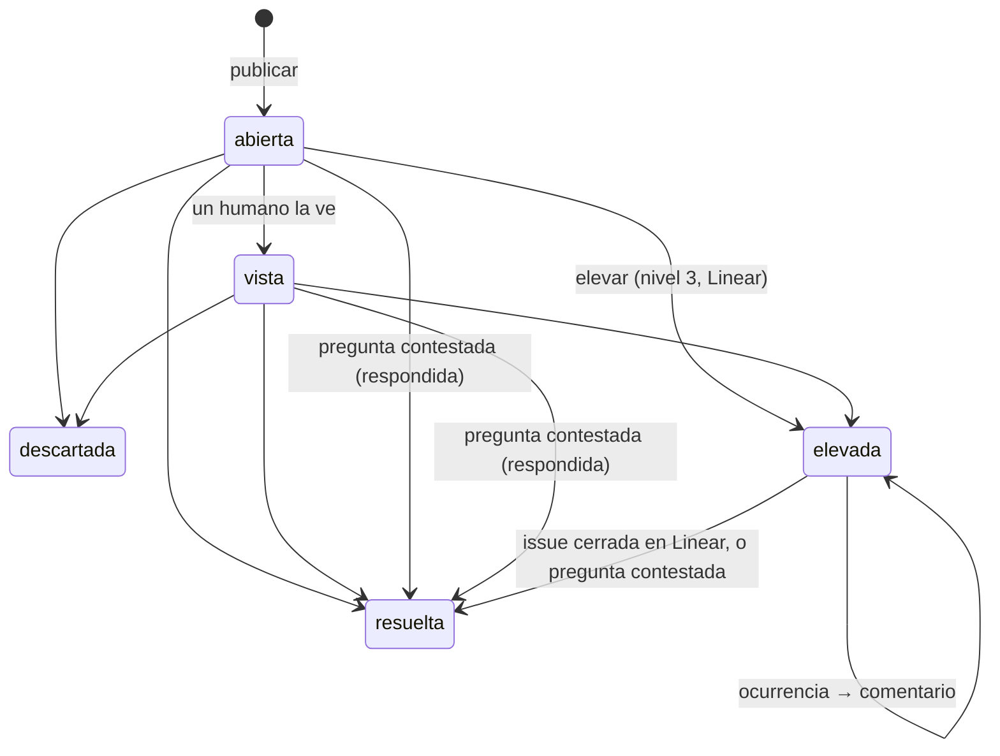

# 143 — Bandeja de notificaciones

**Estado:** Listo para implementar. Las decisiones están cerradas (tabla «Decisiones del 03/11»).  
**Fecha:** 2026-10-30. Ampliada el 2026-11-03 ([DEV-218](https://linear.app/suplai-sales/issue/DEV-218)).  
**Repos:** `backend-supabase` (modelo, servicio, endpoints internos, elevación a Linear, tools, productores), `suplai-sales-claude-plugin` (skill, manual y guía de la tarea programada), `suplai-platform` (este spec).  
**Rama sugerida:** `feat/dev-58-bandeja-notificaciones`  
**Linear:** proyecto «P3 - Nivel 3 · Escalamiento a Faka». El spec es [DEV-55](https://linear.app/suplai-sales/issue/DEV-55) y la ampliación [DEV-218](https://linear.app/suplai-sales/issue/DEV-218). Lo implementan DEV-58 a DEV-68 y DEV-219 a DEV-225 (tabla «Issues»).  
**Diagrama:** [Miro · Flujo de notificaciones](https://miro.com/app/board/uXjVESGkfUQ=/)  
**Relaciona:** [125](./125-notificaciones-cola-canales.md) (cola, suscripciones y envíos), [132](./132-mcp-para-agentes-y-humanos.md) (memoria del tenant), [134](./134-mvp-equipo-de-agentes.md) (equipo de agentes), [136](./136-agentes-modelo-de-datos.md) (trabajos, propuestas, `core.agentes_avisos`), [137](./137-agentes-eventos-webhooks-scheduler.md) (outbox y agendas), [139](./139-agentes-tools-mcp.md) (tools de los bots), [141](./141-agentes-reportes.md) (correo de reporte), [142](./142-agentes-prueba-cordoba-frost.md) (prueba en Córdoba Frost).

---

## Objetivo

Que lo que necesita la atención de alguien quede guardado como una fila con dueño, hasta que alguien lo resuelva, lo descarte, lo conteste o lo eleve. Hoy lo que falla se avisa y se pierde: un WhatsApp, un mail o una línea de log. Nadie sabe qué sigue pendiente.

La bandeja va arriba de la cola de la spec 125. La 125 resuelve **cómo llega** un aviso: quién está suscripto, por qué canal, con qué reintento. La bandeja guarda **qué queda pendiente**.

Tres niveles, del Customer Success escalonado:

| Nivel | Quién lo resuelve | Ejemplo |
|---|---|---|
| 1 | La distribuidora | Un cliente pidió hablar con alguien. Meta rechazó un envío por falta de pago. Un agente pregunta si el pan dulce se vendió por otro canal |
| 2 | El equipo de agentes | Una incidencia de ERP que un bot puede revisar antes que un humano |
| 3 | Faka (Suplai) | Una tool del MCP tira una excepción. Una distribuidora pide una mejora desde Claude. El análisis de un envío ve una oportunidad |

**El nivel 3 es el backlog central de Suplai.** Todo lo que le llega a Faka termina como issue en P3, con la etiqueta `Origen`:

| `motivo` | Etiqueta `Origen` | Qué es |
|---|---|---|
| `solicitud` | `Solicitud` | Lo pidió un cliente: un problema, una pregunta sin respuesta, una mejora |
| `proactiva` | `Proactiva` | Trabajo que propone Suplai o un agente: una oportunidad, una hipótesis para confirmar |
| `detectada` | `Detectada` | Una falla que detectó el sistema: un cron, un healthcheck, un error del MCP |

**El humano no aprueba propuestas: les da contexto a los agentes.** Un agente que duda publica una pregunta. La distribuidora (nivel 1) o Faka (nivel 3) la contesta desde Claude. Con la respuesta, el agente resuelve solo. Lo que sirve para la próxima vez queda como aprendizaje del tenant.

**Todo se atiende desde Claude**, en la compu o en el teléfono. No hay modo admin por WhatsApp. El recordatorio es una tarea programada en Claude, que la guía del conector recomienda, más el resumen por mail.

### Criterios de aceptación

- Publicar dos veces la misma clave, mientras la primera sigue activa, deja una sola notificación con `ocurrencias = 2`. No se crea otra fila.
- Publicar una clave cuya notificación ya está cerrada crea una fila nueva.
- Cada notificación tiene tipo, estado, nivel, origen, motivo, severidad, clave, contexto e historial. Cada cambio de estado deja una acción en el historial con el canal (`mcp`, `mail`, `agente`, `linear`, `sistema`) y quién la hizo.
- Una pregunta guarda la pregunta y sus opciones. Contestarla desde Claude guarda la respuesta, quién y cuándo, deja la acción `respondida` y la cierra. El agente que preguntó la lee por id.
- Un agente guarda un aprendizaje con la pregunta como fuente. Otro agente del mismo tenant lo ve con `buscar_aprendizajes`. Uno de otro tenant no.
- Una notificación de nivel 1 que corresponde avisar encola un trabajo `notificaciones_pendientes` en la cola de la 125. Diez notificaciones normales en una hora generan un solo mail por destino suscripto. Una crítica sale sola, en el momento.
- Desde Claude, un usuario de la distribuidora ve los pendientes agrupados por severidad, con las preguntas aparte, y resuelve, descarta, contesta o eleva con borrador y `confirmar`.
- Elevar a nivel 3 crea una issue en P3 con la etiqueta `Origen` según el `motivo`. Si ya hay una issue abierta para esa clave, suma un comentario. Cerrar la issue en Linear resuelve la notificación.
- Lo `critica` que llega al nivel 3, directo o elevado, manda un solo mail a Faka en el momento. Repetirlo no manda otro. Una `alta` no manda nada.
- Cerrar en Linear una issue que vino de un tenant le avisa a ese tenant «Se atendió: …», con el comentario `Para el cliente:` como resumen. Una de plataforma no avisa a nadie.
- Una mejora pedida desde Claude aparece en P3 con `Solicitud` y la etiqueta del tenant. Pedirla dos veces suma una ocurrencia.
- La issue no lleva teléfonos, mails, nombres de clientes ni tokens.
- Los errores del MCP siguen escalando igual que con la versión directa de DEV-65: una issue por huella, comentario por ocurrencia, y los `AccionError` no escalan.

---

## Cómo está hoy

Verificado en Suplai-east el 03/11, solo lectura.

**Cola de avisos (125).** `public.notification_jobs`, `public.notification_deliveries`, `public.notification_subscriptions` y `public.notification_event_config` existen. `notification_jobs.event_type` no tiene check: un tipo nuevo no pide migración en esa tabla. Pero `tenant_id` es NOT NULL con FK a `distribuidoras` en `notification_jobs`, `notification_deliveries` y `notification_subscriptions`, y la idempotencia es única en `(tenant_id, idempotency_key)`. Un aviso sin tenant, como el mail a Faka por una caída de plataforma, hoy no entra. La lista de tipos válidos vive en código, `EVENTOS` de `services/notificaciones_reglas.py` (`order_confirmed`, `asistencia_humana`, `error_sistema`). El worker es `services/notificaciones_worker.py` y el acceso a datos `data_access/notificaciones.py`. Las tools del conector que operan sobre suscripciones se llaman hoy `buscar_notificaciones` y `editar_notificaciones`.

**Incidencias de ERP.** `core.erp_incidencias` ya tiene su propio ciclo: `severidad` (`critica`, `alta`, `normal`), `estado` (`abierta`, `en_revision`, `propuesta`, `resuelta`, `ignorada`, `escalada`), `veces`, `primera_vez` y `ultima_vez`. Al 03/11 hay 1668 abiertas de severidad `normal`, 29 `alta` abiertas y 24 en `propuesta`, 3 `critica` abiertas, y 6 escaladas (1 `critica`, 5 `alta`). Si la bandeja copiara todas, nadie la leería. Desde el 03/11 corre además el chequeo diario de salud (`core.erp_salud_fotos`, DEV-107), que abre incidencias de regla `salud`.

**Jobs.** `core.jobs` (colas `erp:alta`, `erp:sync`, `erp:bulk`, `sistema`) termina en `dead` cuando agota intentos. Hoy un `dead` solo se ve consultando la tabla.

**Asistencia humana.** El agente crea un `{schema}.ia_tickets` y el observer encola `asistencia_humana` en la 125. El ticket se cierra con `status` y `closed_at`. Nadie más sabe si quedó abierto.

**Equipo de agentes (134/136).** En `main` existen `core.agentes_trabajos`, `core.agentes_runs` y `core.agentes_traza`. `core.agentes_avisos` está en el 136 pero todavía no está creada. La «Bandeja» del backoffice agéntico (spec 135) lista Preguntas y Propuestas (`core.mcp_borradores` en `pendiente_aprobacion` con `bot_id`), y su decisión se guarda con `canal_decision = bandeja`.

**Memoria del tenant (132).** `core.tenant_memoria` guarda tres textos por tenant: `playbook`, `objetivos` (uno vigente cada uno, con versiones) y `resultados` (se suman). Se escribe con `editar_memoria` y se lee con `ver_memoria`. Es texto largo que arma un humano o un agente con borrador. No guarda respuestas puntuales ni su fuente.

**Solicitudes desde Claude.** `reportar_problema` termina en `confirmar_reporte` → `submit_feedback` (`services/mcp_operacion.py`, `services/product_feedback.py`, tabla `public.product_feedback`). `pregunta_sin_respuesta` guarda en `core.preguntas_sin_respuesta` para que el equipo documente. Ninguna de las dos llega a Linear. No hay tool para pedir una mejora.

**Errores del MCP.** Cuando una tool falla, el conector sugiere `reportar_problema`. Depende de que alguien lo pida. DEV-65 (en revisión) es la versión directa que crea la issue en Linear por huella.

**Linear.** El proyecto P3 existe y es el backlog central, con las etiquetas `Origen` (`Solicitud`, `Proactiva`, `Detectada`). El backend no tiene cliente de Linear ni webhook de Linear.

---

## Decisiones del 03/11

Las tomó Faka el 03/11. Las issues de decisión están cerradas.

| Tema | Decisión | Issue |
|---|---|---|
| Nombre | La bandeja se llama «Notificaciones» (`buscar_notificaciones`, `editar_notificaciones`). Lo de la 125 pasa a `buscar_suscripciones_avisos` y `editar_suscripciones_avisos`, con alias durante un mes | [DEV-56](https://linear.app/suplai-sales/issue/DEV-56) |
| Qué es grave | La tabla de «Severidad y nivel por caso», con elevación automática por tiempo para las críticas y altas de nivel 1 marcadas. Un cron cada 15 minutos la aplica | [DEV-19](https://linear.app/suplai-sales/issue/DEV-19) |
| Crítica al nivel 3 | Mail inmediato a Faka. Lo demás, Faka lo atiende desde Linear cuando tiene tiempo | [DEV-220](https://linear.app/suplai-sales/issue/DEV-220) |
| Modo admin por WhatsApp | No se hace. Tampoco la plantilla «Tenés N pendientes». Todo se atiende desde Claude, también desde el teléfono. La autorización del modo admin ya no aplica | [DEV-57](https://linear.app/suplai-sales/issue/DEV-57) ya no aplica. [DEV-62](https://linear.app/suplai-sales/issue/DEV-62) y [DEV-63](https://linear.app/suplai-sales/issue/DEV-63) canceladas |
| Recordatorio | Tarea programada en Claude, que recomienda la guía del conector, más el resumen por mail | [DEV-225](https://linear.app/suplai-sales/issue/DEV-225), [DEV-64](https://linear.app/suplai-sales/issue/DEV-64) |
| Nivel 3 | Es el backlog central: solicitudes, trabajo proactivo y fallas detectadas, con la etiqueta `Origen` | [DEV-218](https://linear.app/suplai-sales/issue/DEV-218) |
| Interacción | El humano no aprueba propuestas: contesta preguntas. Con la respuesta, el agente resuelve solo | [DEV-219](https://linear.app/suplai-sales/issue/DEV-219), [DEV-199](https://linear.app/suplai-sales/issue/DEV-199) |

---

## Decisiones de diseño técnico

| Decisión | Elección | Por qué | Alternativa descartada |
|---|---|---|---|
| Relación con la 125 | La bandeja guarda el pendiente. Para avisar, encola tipos nuevos en la 125: `notificaciones_pendientes`, `nivel3_critica` y `notificacion_atendida` | La cola ya reintenta, registra entregas y sabe quién está suscripto. La bandeja no manda nada por su cuenta | Un envío propio desde la bandeja, o meter el estado del pendiente en `notification_jobs` |
| Dónde vive | `core.notificaciones`, `core.notificaciones_acciones` y `core.aprendizajes`, con `distribuidora_id` y `schema_name` en cada fila | Mismo patrón que `core.mcp_borradores`, `core.erp_incidencias` y `core.agentes_*`. Una migración vale para todos los tenants. Nivel 3 se lista sin cruzar schemas | Una tabla por schema de tenant |
| Notificación sin tenant | `schema_name` null solo con nivel 3 | Un error de plataforma (el MCP entero, el worker) no es de ninguna distribuidora | Inventar un tenant `suplai` |
| Tipo | `tipo` `aviso` o `pregunta`. Una pregunta es una notificación más: mismo estado, nivel, clave y elevación | Quien contesta mira un solo lugar. La pregunta cuenta en los pendientes y puede elevarse | Una tabla de preguntas aparte |
| `motivo` y `origen` | Dos columnas. `origen` dice quién publicó (`cron`, `mcp_error`, `usuario_mcp`, …). `motivo` dice por qué existe (`solicitud`, `proactiva`, `detectada`) y se mapea a la etiqueta `Origen` de Linear | Un cron puede publicar algo proactivo (el análisis de un envío) y un bot algo detectado. Una sola columna mezcla las dos cosas | Derivar el motivo del origen |
| Motivo por defecto | `mcp_error` y `cron` → `detectada`. `usuario_mcp` → `solicitud`. `agente_autonomo` lo elige el bot. El productor puede pisarlo | La mayoría no lo tiene que pensar | Obligatorio en cada publicación |
| Duplicados | Clave única entre las activas: `(coalesce(schema_name, ''), clave)` donde `estado in ('abierta', 'vista', 'elevada')`. Repetir suma `ocurrencias` y mueve `ultima_vez` | Es el mismo criterio que `veces` en `core.erp_incidencias`. Un error que se repite cien veces es un pendiente, no cien | Una fila por evento, agrupada al leer |
| Clave repetida después de cerrar | Fila nueva, con `anterior_id` a la cerrada | Si volvió, es otra vez un pendiente. El historial de la anterior no se mezcla | Reabrir la fila cerrada |
| Severidad al repetir | Queda la mayor entre la guardada y la nueva. Nunca baja sola | Una repetición crítica de algo normal tiene que verse | Pisar con la última |
| Ocurrencias en el historial | No dejan acción. Solo suben el contador | Mil ocurrencias llenarían el historial. Ahí van las decisiones | Una fila de historial por ocurrencia |
| Contestar una pregunta | Guarda `respuesta`, `respondida_por` y `respondida_at`, deja la acción `respondida` y pasa a `resuelta`. El agente lee la fila por id y sigue | Con la respuesta el pendiente humano terminó. Lo que hace el agente después es su trabajo, no un pendiente de la bandeja | Un estado `respondida` intermedio que el agente cierra, o un borrador que el humano aprueba |
| Pregunta elevada | Una pregunta de nivel 3 va a Linear como cualquier otra. Faka la contesta desde Claude; el servicio comenta la respuesta en la issue y la pasa a Done | Faka trabaja en Claude y en Linear. La respuesta queda en la bandeja, que es lo que lee el agente | Contestar con un comentario en Linear que el webhook interprete |
| Aprendizajes | `core.aprendizajes`, una fila por hecho, con tema, texto, fuente y `vigente`. Se lee por endpoint (`GET /internal/aprendizajes`) o por tool (`buscar_aprendizajes`), nunca por archivo | Tiene que servir para Grok hoy y para la infraestructura propia después. Un endpoint lo lee cualquiera | Archivos en el repo o en un bucket |
| Aprendizajes y memoria | Conviven. `core.tenant_memoria` (132) es el texto largo del tenant: playbook, objetivos, resultados. `core.aprendizajes` son hechos cortos por tema, con su fuente | Un hecho puntual («el pan dulce de almaro también se vende en mostrador») no reescribe el playbook. Con la fuente se sabe de dónde salió | Sumar una parte `aprendizajes` a `core.tenant_memoria` |
| Quién guarda un aprendizaje | El agente, con la pregunta respondida como fuente. Un humano puede corregirlo o darlo de baja desde Claude | El agente sabe qué parte de la respuesta sirve para la próxima. El humano no aprueba, pero puede corregir | Que cada respuesta sea un aprendizaje automático |
| Publicar | Servicio `services/notificaciones_bandeja.py` (`publicar`). Los productores del backend lo llaman directo. Los de afuera (agente, runtime de agentes) usan `POST /internal/notificaciones` | Un solo camino de dominio. El HTTP es solo para quien no corre en el backend | Que cada productor escriba la tabla |
| Auth de los endpoints internos | `Authorization: Bearer` con `NOTIFICACIONES_INTERNAL_TOKEN` (variable de Railway, compartida con el agente) y `x-schema-name`. Los bots usan su token por run del 139 en lugar del endpoint | El backend no tiene hoy auth interna entre servicios para esto. El token por run ya identifica tenant y bot | Endpoint abierto con el header de tenant |
| Cuándo se avisa al tenant | Solo nivel 1, por mail. Nivel 2 lo leen los bots. Nivel 3 va a Linear | La distribuidora ve todo en Claude; el mail es el recordatorio. Faka ya mira Linear | Avisar a todos los niveles, o por WhatsApp |
| Anti-spam | Un trabajo `notificaciones_pendientes` pendiente por tenant. Al publicar, si no hay, se crea con `available_at = ahora + ventana(severidad)`. Si hay, `available_at` baja al menor de los dos. Ventana: `normal` 4 h, `alta` 1 h. Configurable en `metadata.notificaciones.ventanas` | Diez normales en una hora se juntan en un aviso. Una alta no espera cuatro horas | Ventanas fijas del reloj (00–04, 04–08), que avisan a las 03:59 lo de las 03:58 y a las 04:00 lo de las 00:01 |
| Crítica de nivel 1 | Trabajo propio con clave `notificaciones_pendientes:critica:{id}` y `available_at` ahora | Lo que frena el servicio no espera la ventana | Meterla en la ventana con espera cero, que despacharía antes lo normal acumulado |
| Crítica de nivel 3 | Trabajo `nivel3_critica` con clave `nivel3_critica:{notificacion_id}`, `tenant_id` null y destino `NIVEL3_CRITICA_MAIL` (facundo@suplaisales.com). Se encola al llegar a nivel 3 con `critica`: al publicar, al elevar o al subir a `critica` estando elevada | Lo que no es urgente espera en Linear. Lo crítico no. La clave por id hace que una repetición no mande otro mail | Una suscripción de la 125 para Faka, que hoy pide un tenant |
| Avisos sin tenant en la 125 | La migración deja `tenant_id` null en `notification_jobs` y `notification_deliveries` solo para `event_type = 'nivel3_critica'` (check), con un único parcial `(idempotency_key) where tenant_id is null` | Un error de plataforma no tiene tenant y tiene que llegar igual. El check acota el cambio a ese tipo | Colgar el aviso de un tenant cualquiera, o una cola aparte |
| Qué dice el aviso | Se cuenta al enviar, no al encolar. Si al enviar no queda nada abierto, el trabajo termina `done` sin deliveries | Lo resuelto en la ventana no se avisa | Congelar la cuenta en el payload |
| Quién recibe | Las suscripciones de la 125 con el tipo en `event_types` | Mismo modelo que ya se edita desde el conector | Una lista de destinatarios propia de la bandeja |
| Estado `vista` | La marca la tool que lista, cuando un humano ve la notificación desde Claude | Separa lo que nadie miró de lo que alguien vio y no cerró | Marcarla al enviar el mail |
| Elevar | Pasa a nivel 3 y estado `elevada`, guarda `nivel_origen`, crea o comenta la issue de Linear | El nivel 3 es Linear. La fila sigue viva hasta que la issue se cierra | Elevar sin Linear, o crear la issue a mano |
| Dedupe en Linear | La fila activa guarda `linear_issue_id`. Misma clave activa → comentario en esa issue. La descripción lleva una línea `clave: <clave>` | Una issue por problema, con el conteo de ocurrencias en los comentarios | Buscar en Linear por título |
| Etiquetas en Linear | `Origen` según `motivo`, la etiqueta del tenant si existe y `Bug` solo con `detectada` | El triage de P3 ordena por `Origen` (DEV-224). Una mejora no es un bug | `Bug` fijo |
| Severidad → prioridad | `critica` → 1 Urgente, `alta` → 2, `normal` → 3 | Es la regla de prioridad que ya usa el equipo en Linear | Prioridad fija |
| Cierre desde Linear | Webhook `POST /webhooks/linear`, firmado con `LINEAR_WEBHOOK_SECRET`. Issue a un estado de tipo `completed` o `canceled` → notificación `resuelta`, acción con canal `linear` | Faka cierra donde trabaja | Pollear Linear desde un cron |
| Aviso de vuelta | Al cerrar desde Linear una notificación con tenant, el servicio busca el último comentario de la issue que empieza con `Para el cliente:`, lo guarda en `resumen_cierre` y encola `notificacion_atendida` en la 125. Va a los suscriptos del tenant a ese tipo y al mail de quien la pidió (`contexto.usuario_id`). `canceled` dice «No se va a hacer». Sin comentario, dice solo que se atendió | Quien pidió algo se entera de que se hizo, en palabras para él. Faka elige qué se le dice | Mandar el último comentario cualquiera, que puede ser técnico |
| Datos en la issue | Tenant, tipo, origen, motivo, productor, severidad, ocurrencias, ids de contexto (cliente, pedido, conversación, trabajo) y la línea `clave`. Una solicitud lleva la descripción en palabras del cliente, saneada. Sin teléfonos, mails, nombres de clientes ni argumentos crudos | Linear es un tercero y lo lee gente fuera del tenant | Copiar el `detalle` completo |
| Resolución por el productor | El productor puede llamar a `resolver` con la misma clave: un healthcheck que vuelve, una incidencia de ERP resuelta, un ticket cerrado | Lo que se arregla solo no queda abierto. La acción queda con canal `sistema` | Que siempre la cierre un humano |
| Bandeja de agentes (135/136) | Conviven. La Bandeja del backoffice agéntico es donde se deciden Propuestas de un trabajo. Esta es la de pendientes y preguntas. No son la misma tabla | Una Propuesta ya tiene su fila en `core.mcp_borradores`, su riesgo y su decisión. Copiarla sería una segunda fuente de verdad | Mover Propuestas a `core.notificaciones` |
| `core.agentes_avisos` | Sigue como registro de avisos de trabajos (136). No se crea un segundo registro de envíos: los dos encolan en la 125 | El aviso de un reporte listo no es un pendiente | Fusionar ahora, antes de que exista esa tabla |
| Capas | Tool MCP → servicio de dominio → `data_access/notificaciones_bandeja.py` y `data_access/aprendizajes.py`. El cliente de Linear vive en `services/linear_cliente.py` | Igual que la 125 | SQL en `mcp_server/`, o que la tool llame al router |

---

## Severidad y nivel por caso

Decidido en DEV-19. Define nivel, motivo y severidad por caso, y si se eleva sola. Revisar después de dos semanas con datos.

| Caso | Productor | Nivel | Motivo | Severidad | Se eleva sola |
|---|---|---|---|---|---|
| Backend, MCP o agente sin responder | Monitor externo (DEV-20) | 3 | `detectada` | `critica` | Ya es 3 |
| El agente de WhatsApp recibe mensajes y no responde en 10 minutos | Healthcheck del agente | 3 | `detectada` | `critica` | Ya es 3 |
| Meta rechaza por falta de pago (`131042`, `141006`) | `meta_billing_health`, ticket `[META_BUSINESS_PAYMENT_ERROR]` | 1 | `detectada` | `critica` | Sí, si sigue abierta a las 24 h |
| Excepción no esperada en una tool del MCP | Handler de errores del MCP (DEV-65) | 3 | `detectada` | `alta` | Ya es 3 |
| Credencial del ERP inválida o vencida | Sync ERP | 1 | `detectada` | `alta` | Sí, a las 48 h |
| Sync ERP que muere por un error nuestro (tres `dead` del mismo tipo en una hora) | `core.jobs` | 3 | `detectada` | `alta` | Ya es 3 |
| Pedido confirmado que no entró al ERP (`pedido_push` en `dead`) | `core.jobs` | 1 | `detectada` | `critica` | Sí, a las 2 h |
| Incidencia de ERP `critica` | `core.erp_incidencias` | 1 | `detectada` | `critica` | Sí, a las 24 h |
| Incidencia de ERP `alta` | `core.erp_incidencias` | 1 | `detectada` | `alta` | No |
| Incidencia de ERP `normal` | — | No publica | — | — | — |
| Pedido de asistencia humana | `ia_tickets` | 1 | `solicitud` | `normal` | No |
| Aviso de la 125 que quedó `dead` | Worker de la 125 | 1 | `detectada` | `normal` | No |
| Problema reportado desde Claude | `reportar_problema` | 3 | `solicitud` | `alta` | Ya es 3 |
| Pregunta que la guía no responde | `pregunta_sin_respuesta` | 3 | `solicitud` | `normal` | Ya es 3 |
| Mejora pedida desde Claude | `pedir_mejora` | 3 | `solicitud` | `normal` | Ya es 3 |
| Hipótesis del análisis post-envío que pide confirmación | Análisis nocturno (DEV-223) | 1 o 3 (pregunta) | `proactiva` | `normal` | No |
| Oportunidad clara del análisis post-envío | Análisis nocturno (DEV-223) | 3 | `proactiva` | `normal` | Ya es 3 |
| Fricción o duda que un bot no puede resolver | Agentes autónomos (DEV-68) | 1 o 3, lo decide el bot | lo decide el bot | `normal` | No |
| Trabajo de agentes `fallido` | Runtime de agentes (137) | 3 | `detectada` | `normal` | Ya es 3 |

La elevación automática la aplica un cron cada 15 minutos y deja la acción con canal `sistema`.

---

## Alcance

### Incluido

- Tablas `core.notificaciones`, `core.notificaciones_acciones` y `core.aprendizajes`, en una sola migración (DEV-58).
- Servicio de dominio: publicar, resolver por clave, listar, marcar vista, resolver, descartar, responder, elevar, y guardar, buscar y dar de baja aprendizajes.
- `POST /internal/notificaciones` idempotente y `GET /internal/aprendizajes` (DEV-59).
- Cliente de Linear, etiquetas `Origen`, webhook de cierre y cron de elevación automática (DEV-60).
- Tools del conector para ver, resolver, descartar, contestar y elevar, y para ver y corregir aprendizajes (DEV-61).
- Preguntas con respuesta y aprendizajes por tenant (DEV-219).
- Tipo `notificaciones_pendientes` en la cola de la 125, con la ventana anti-spam y el trabajo propio de las críticas, por mail con Brevo (DEV-64).
- Mail inmediato a Faka por lo `critica` de nivel 3, tipo `nivel3_critica` (DEV-220).
- Aviso de vuelta al cliente al cerrar una issue elevada, tipo `notificacion_atendida` (DEV-221).
- Solicitudes desde Claude como productor: `reportar_problema`, `pregunta_sin_respuesta` y la tool nueva `pedir_mejora` (DEV-222).
- Análisis nocturno post-envío como productor proactivo (DEV-223).
- Productores: errores del MCP (DEV-65), crons (DEV-66), `ia_tickets` (DEV-67) y agentes autónomos (DEV-68).
- Guía del conector con la tarea programada en Claude (DEV-225).
- Rutina de atención del nivel 3 como skill (DEV-224).

### Fuera de alcance

- Modo admin por WhatsApp y plantilla «Tenés N pendientes». Decidido el 03/11: todo se atiende desde Claude.
- Avisos de la bandeja por WhatsApp. El aviso al tenant es por mail; el aviso de vuelta también.
- Pantalla de la bandeja en el backoffice. Se lee desde Claude.
- Acciones desde el mail. El mail es un resumen; para actuar se va a Claude.
- El monitor externo que detecta una caída del backend (DEV-20). Si el backend está caído no puede publicar en su propia bandeja; ese monitor va directo a Linear o a Faka.
- Mover Propuestas del equipo de agentes a esta bandeja.
- Nivel 2 con bots que tomen pendientes solos. El modelo lo soporta; ningún bot los lee en esta entrega.
- Contestar una pregunta desde Linear. Se contesta desde Claude.
- Cambiar el aviso de la 125 al vendedor por `asistencia_humana` o el mail de `error_sistema`. Siguen igual.
- Migrar `core.tenant_memoria` o `core.preguntas_sin_respuesta` a las tablas nuevas.

---

## Modelo

DEV-58 crea todo esto en una sola migración.

### `core.notificaciones`

| Columna | Tipo | Uso |
|---|---|---|
| `id` | uuid PK default `gen_random_uuid()` | |
| `distribuidora_id` | uuid FK `public.distribuidoras` | Null solo con nivel 3 |
| `schema_name` | text | Null solo con nivel 3. Check: `schema_name is not null or nivel = 3` |
| `tipo` | text NOT NULL default `'aviso'` | `aviso`, `pregunta`. Check |
| `nivel` | smallint NOT NULL | 1, 2 o 3. Check |
| `nivel_origen` | smallint NOT NULL | El nivel con que se publicó. Elevar cambia `nivel`, no este |
| `origen` | text NOT NULL | Quién publicó: `cron`, `agente_autonomo`, `agente_vendedor`, `mcp_error`, `usuario_mcp`. Check |
| `motivo` | text NOT NULL | Por qué existe: `solicitud`, `proactiva`, `detectada`. Check. Se mapea a la etiqueta `Origen` de Linear |
| `productor` | text NOT NULL | Qué la publicó, más fino que el origen: `erp_incidencias`, `core.jobs`, `healthcheck_agente`, `meta_billing`, `ia_tickets`, `notification_jobs`, `mcp_tool`, `reportar_problema`, `pregunta_sin_respuesta`, `pedir_mejora`, `analisis_post_envio`, `bot:<rol>` |
| `severidad` | text NOT NULL | `critica`, `alta`, `normal`. Mismos valores que `core.erp_incidencias`. Check |
| `estado` | text NOT NULL default `'abierta'` | `abierta`, `vista`, `resuelta`, `elevada`, `descartada`. Check |
| `clave` | text NOT NULL | La arma el productor. Ver «Claves» |
| `titulo` | text NOT NULL | Una línea, hasta 140 caracteres. Sin datos personales. Check de largo |
| `detalle` | text | Para el humano del tenant. No sale a Linear |
| `contexto` | jsonb NOT NULL default `'{}'` | Refs de negocio: `cliente_id`, `pedido_id`, `conversacion_id`, `trabajo_id` (spec 136), `incidencia_id`, `job_id`, `ticket_id`, `agenda_id`, `tool`, `usuario_id` (quien la pidió). Solo ids |
| `pregunta` | text | Con `tipo = pregunta`: la pregunta en lenguaje natural. Check: no null si es pregunta |
| `opciones` | jsonb | Con `tipo = pregunta`: los candidatos, `[{"id": "a", "texto": "…"}]`. Puede faltar: la respuesta libre siempre vale |
| `respuesta` | jsonb | `{"opcion": "a" \| null, "texto": "…"}`. Solo con `tipo = pregunta` |
| `respondida_por` | text | Id del usuario que contestó. No el mail |
| `respondida_at` | timestamptz | |
| `resumen_cierre` | text | El comentario `Para el cliente:` de Linear, sin el prefijo. Lo usa el aviso de vuelta |
| `ocurrencias` | int NOT NULL default 1 | |
| `primera_vez`, `ultima_vez` | timestamptz NOT NULL default `now()` | |
| `vista_at`, `cerrada_at` | timestamptz | `cerrada_at` al pasar a `resuelta` o `descartada` |
| `elevar_desde` | timestamptz | Cuándo se eleva sola si sigue abierta. Null si no aplica |
| `linear_issue_id`, `linear_issue_key` | text | Al elevar. `DEV-123` en la key |
| `anterior_id` | uuid FK `core.notificaciones` | La fila cerrada con la misma clave, si la hay |
| `created_at`, `updated_at` | timestamptz NOT NULL default `now()` | |

Checks de preguntas: `tipo = 'pregunta'` exige `pregunta`. `respuesta`, `respondida_por` y `respondida_at` van juntos y solo con `tipo = 'pregunta'`.

Índices:

- Único parcial `(coalesce(schema_name, ''), clave)` donde `estado in ('abierta', 'vista', 'elevada')`.
- `(schema_name, nivel, estado, severidad)` para listar.
- `(schema_name, tipo, estado)` donde `tipo = 'pregunta'`, para las preguntas pendientes.
- `(linear_issue_id)` para el webhook.
- `(elevar_desde)` donde `estado in ('abierta', 'vista')` para el cron.

### `core.notificaciones_acciones`

| Columna | Tipo | Uso |
|---|---|---|
| `id` | bigserial PK | |
| `notificacion_id` | uuid FK NOT NULL | |
| `distribuidora_id`, `schema_name` | uuid, text | Copiados de la notificación |
| `accion` | text NOT NULL | `publicada`, `vista`, `resuelta`, `descartada`, `respondida`, `elevada`, `comentada_linear`, `reabierta_linear`, `avisada_cliente`. Check |
| `canal` | text NOT NULL | `mcp`, `mail`, `agente`, `linear`, `sistema`. Check |
| `actor_tipo` | text NOT NULL | `usuario`, `super_admin`, `bot`, `sistema`. Check |
| `actor` | text | Id de usuario, id de bot o nombre del productor. Nunca un teléfono o un mail |
| `razon` | text | Obligatoria en `descartada` y `elevada`. Se llama `razon` para no confundirla con `motivo` de la notificación |
| `created_at` | timestamptz NOT NULL default `now()` | |

Índice `(notificacion_id, created_at)`.

Las filas no se editan: la migración revoca `UPDATE` y `DELETE` al rol de la app, como en `core.agentes_certificados`.

### `core.aprendizajes`

| Columna | Tipo | Uso |
|---|---|---|
| `id` | uuid PK default `gen_random_uuid()` | |
| `distribuidora_id` | uuid FK NOT NULL | Siempre de un tenant |
| `schema_name` | text NOT NULL | |
| `tema` | text NOT NULL | Slug corto para buscar: `campanas`, `catalogo`, `clientes`, `erp`, `precios`, `logistica`, u otro que elija el agente. Minúsculas, sin espacios. Check de formato, no de lista |
| `texto` | text NOT NULL | El hecho, en una o dos frases. Hasta 1000 caracteres. Sin datos personales |
| `fuente_tipo` | text NOT NULL | `notificacion`, `humano`, `agente`. Check |
| `fuente_notificacion_id` | uuid FK `core.notificaciones` | La pregunta de la que salió. Obligatoria con `fuente_tipo = notificacion` |
| `autor` | text NOT NULL | Id de bot (`bot:<rol>`), id de usuario o `grok` |
| `vigente` | boolean NOT NULL default true | Dar de baja pone false. No se borra |
| `reemplaza_id` | uuid FK `core.aprendizajes` | Si corrige a otro, ese queda `vigente = false` |
| `created_at`, `updated_at` | timestamptz NOT NULL default `now()` | |

Índices: `(schema_name, tema)` donde `vigente`, y `(fuente_notificacion_id)`.

### Cola de la 125

Sin tablas nuevas. La misma migración:

- Deja `tenant_id` null en `public.notification_jobs` y `public.notification_deliveries`, con check `tenant_id is not null or event_type = 'nivel3_critica'`.
- Suma el único parcial `(idempotency_key)` donde `tenant_id is null` en `notification_jobs`. El único actual `(tenant_id, idempotency_key)` no deduplica nulls.

Los tipos `notificaciones_pendientes`, `nivel3_critica` y `notificacion_atendida` se suman en `EVENTOS` de `services/notificaciones_reglas.py`. `nivel3_critica` no se suscribe desde el conector: su destino es `NIVEL3_CRITICA_MAIL`.

### Claves

La clave dice «es el mismo problema». La arma el productor y no lleva datos personales.

| Productor | Clave |
|---|---|
| Error del MCP | `mcp_error:{huella}`, con la huella de DEV-65: `sha1(tool + tipo de error + mensaje normalizado)` |
| Incidencia de ERP | `erp_incidencia:{id}` |
| Job muerto | `job_dead:{tipo}`. Agrupa por tipo, no por job |
| Pedido sin ERP | `pedido_sin_erp:{pedido_id}` |
| Meta sin pago | `meta_billing` |
| Healthcheck | `health:{servicio}` |
| Asistencia humana | `ia_ticket:{ticket_id}` |
| Aviso muerto de la 125 | `aviso_dead:{event_type}` |
| Problema reportado | `reporte:{huella}`, con `sha1(texto normalizado)` |
| Pregunta sin respuesta | `pregunta_sin_respuesta:{huella}`, con `sha1(pregunta normalizada)` |
| Mejora pedida | `mejora:{huella}`, con `sha1(título normalizado)` |
| Análisis post-envío | `analisis:{agenda_id}:{fecha}:{slug}`, el slug por hipótesis u oportunidad |
| Bot | `bot:{rol}:{trabajo_id}:{slug}`, el slug lo elige el bot |

Normalizar es pasar a minúsculas, sacar tildes, números y espacios repetidos. Dos pedidos con las mismas palabras son una ocurrencia más. Dos con palabras distintas son dos filas; el triage de P3 los junta si hace falta.

### Estados



Una notificación publicada directo en nivel 3 nace `abierta` y se eleva en la misma transacción: pasa a `elevada` con su issue. Las transiciones las hace solo el servicio. Ninguna tool ni productor escribe `estado` directo.

---

## Flujo

Diagrama: [Miro · Flujo de notificaciones](https://miro.com/app/board/uXjVESGkfUQ=/).

```text
productor (cron, MCP, usuario en Claude, agente vendedor, bot, análisis nocturno)
        │  publicar(clave, tipo, nivel, origen, motivo, severidad, título, contexto, [pregunta, opciones])
        ▼
  core.notificaciones          activa con esa clave → ocurrencias + 1
        │
        ├─ nivel 1 ─► notification_jobs `notificaciones_pendientes`   (125)
        │                 ventana por severidad, crítica aparte
        │                 └─ mail: resumen agrupado por severidad, preguntas aparte
        │             la distribuidora lo atiende en Claude (tarea programada, DEV-225)
        │
        ├─ nivel 2 ─► queda para los bots (sin aviso en esta entrega)
        │
        └─ nivel 3 ─► Linear P3: issue nueva con `Origen`, o comentario si la clave ya tiene una
                          ├─ `critica` ─► notification_jobs `nivel3_critica` ─► mail a Faka
                          └─ webhook de Linear al cerrar ─► resuelta
                                 └─ con tenant ─► `notificacion_atendida` ─► mail «Se atendió: …»

pregunta contestada en Claude ─► respuesta en la fila ─► el agente la lee
                                                        └─► core.aprendizajes ─► buscar_aprendizajes
```

**Publicar.** El servicio busca la activa por `(schema_name, clave)` con `FOR UPDATE`. Si existe, suma una ocurrencia, mueve `ultima_vez`, sube la severidad si la nueva es mayor y, si está `elevada`, encola un comentario en la issue. Si no existe, la crea con acción `publicada` y, si hay una cerrada con la misma clave, la apunta en `anterior_id`. Si el caso se eleva solo según la tabla de severidad, guarda `elevar_desde`. Si no viene `motivo`, usa el de su origen. La respuesta es `{id, creada, ocurrencias, estado}`.

**Resolver por clave.** El productor llama a `resolver(clave, razon)`. Si hay una activa, pasa a `resuelta` con canal `sistema`. Si estaba `elevada`, comenta en la issue que se resolvió sola, sin cerrarla: la cierra Faka.

**Aviso de nivel 1.** Solo cuando la notificación es nueva o subió de severidad. Una ocurrencia más de lo mismo no avisa otra vez. El trabajo `notificaciones_pendientes:{tenant}:{n}` se crea o se adelanta según la ventana. Al enviar, el worker cuenta las de nivel 1 en `abierta` o `vista` del tenant, por severidad y con las preguntas aparte, y manda el resumen por Brevo a los mails suscriptos a ese tipo. Si la cuenta es cero, no hay deliveries.

**Crítica de nivel 1.** Encola además `notificaciones_pendientes:critica:{id}` con `available_at` ahora. El mail nombra la crítica («Meta rechazó los envíos por falta de pago») además del total.

**Meta sin pago.** Ya no cambia nada: el aviso de la bandeja es por mail. El backfill de la 125 que suscribe a los usuarios del tenant a `error_sistema` se repite para `notificaciones_pendientes` y `notificacion_atendida`.

**Resumen por mail.** Texto con los pendientes agrupados por severidad (título, antigüedad y ocurrencias), las preguntas sin contestar aparte, y la línea «Pedile a Claude: ver mis notificaciones de Suplai». Una delivery por dirección.

**Recordatorio en Claude.** La guía del conector recomienda una tarea programada, por ejemplo de lunes a viernes a la mañana: «Revisá mis notificaciones de Suplai que requieren acción y las preguntas sin responder; resumime lo urgente y ayudame a contestarlas». Las tools de notificaciones suman una línea que la sugiere mientras el usuario no la tenga (DEV-225).

**Contestar una pregunta.** Desde Claude, con `editar_notificaciones` acción `responder`, borrador y `confirmar`. El servicio guarda la respuesta, `respondida_por` y `respondida_at`, deja la acción `respondida` con canal `mcp` y pasa la fila a `resuelta`. Si estaba `elevada`, comenta la respuesta en la issue y la pasa a Done. No hay un borrador del agente que aprobar: la respuesta es contexto.

**El agente lee la respuesta.** El agente guarda el id de la pregunta en su trabajo. En su próximo run la lee por id (`buscar_notificaciones` con `id`, o el endpoint). Con la respuesta sigue solo. Si lo que aprendió sirve para la próxima, llama a `guardar_aprendizaje` con la pregunta como fuente.

**Aprendizajes.** Antes de actuar, el agente busca los vigentes de su tenant por tema: por ejemplo, antes de armar la próxima campaña. Grok los lee por `GET /internal/aprendizajes?tema=campanas` con `x-schema-name`. Los bots del 139 los leen con `buscar_aprendizajes`. Un humano los ve y los corrige desde Claude. Corregir crea uno nuevo con `reemplaza_id` y deja el anterior `vigente = false`.

**Elevar.** Desde el conector o un bot. Pide razón. El servicio pasa la fila a nivel 3 y `elevada`, guarda la acción y llama a Linear. Si Linear falla, la fila queda `elevada` sin `linear_issue_id` y un job de `core.jobs` (cola `sistema`, tipo `notificacion_elevar`) reintenta. Una issue se crea con:

- Título `[{schema}] {titulo}`, o `[plataforma] {titulo}` sin tenant. Una pregunta lleva `Pregunta:` adelante.
- Proyecto P3, equipo DEV, etiqueta `Origen` según `motivo`, la etiqueta del tenant si existe y `Bug` solo con `detectada`.
- Prioridad según severidad.
- Descripción con tenant, tipo, origen, motivo, productor, severidad, ocurrencias, primera y última vez, ids de contexto, la razón de quien elevó y la línea `clave: <clave>`. Una pregunta lleva la pregunta y las opciones. Una solicitud, la descripción del cliente saneada.

**Mail urgente a Faka.** Cuando una notificación queda en nivel 3 con `critica` (publicada así, elevada así, o subida a `critica` estando elevada), el servicio encola `nivel3_critica` con clave `nivel3_critica:{id}`, `tenant_id` null y `available_at` ahora, después de intentar Linear. El mail lleva título, tenant, origen, motivo, ocurrencias y el link a la issue, sin datos personales. Si Linear falló, dice «issue pendiente» y el id de la notificación. La clave por id hace que una repetición no mande otro mail. Una fila nueva por la misma clave, después de cerrar la anterior, sí manda.

**Cierre desde Linear.** El webhook verifica la firma, mira solo eventos `Issue` de update cuyo estado nuevo es de tipo `completed` o `canceled`, busca la fila por `linear_issue_id` y la pasa a `resuelta` con canal `linear` y el nombre del estado como razón. Una issue reabierta en Linear deja la acción `reabierta_linear` y vuelve la fila a `elevada`, si no hay otra activa con la misma clave.

**Aviso de vuelta.** Si la fila cerrada desde Linear tiene tenant, el servicio lee los comentarios de la issue y toma el último que empieza con `Para el cliente:`. Guarda el resto en `resumen_cierre` y encola `notificacion_atendida:{id}` en la 125. El mail dice «Se atendió: {titulo}» y el resumen. Con `canceled` dice «No se va a hacer: {titulo}» y el resumen si lo hay. Sin comentario, dice solo que se atendió. Va a los mails del tenant suscriptos a `notificacion_atendida` y al mail del usuario de `contexto.usuario_id`, si existe y no está ya en la lista. Deja la acción `avisada_cliente`. Una fila sin tenant no avisa. Una pregunta contestada desde Claude no avisa: quien contestó ya lo sabe. La rutina de atención (DEV-224) deja ese comentario antes de pasar la issue a Done.

**Elevación automática.** Un cron cada 15 minutos toma las filas con `elevar_desde < now()` en `abierta` o `vista` y las eleva con canal `sistema` y la razón «Sin resolver desde {primera_vez}».

---

## Productores

**Errores del MCP (DEV-65).** La versión directa crea o comenta la issue en Linear por huella y no escala los `AccionError`. Para montarla sobre la bandeja sin cambiar el comportamiento:

1. DEV-65 escribe en la descripción de cada issue la línea `clave: mcp_error:{huella}`. Es lo único que se le pide hoy.
2. Cuando la bandeja está en `main`, un script de una vez (`scripts/notificaciones_importar_mcp_errores.py`) lista las issues abiertas de P3 con esa línea y crea, por cada una, una notificación `elevada` con esa clave, `motivo = detectada` y su `linear_issue_id`.
3. El handler de errores reemplaza su llamada directa a Linear por `publicar(nivel=3, origen="mcp_error", productor="mcp_tool", severidad="alta", clave="mcp_error:{huella}")`. La misma huella encuentra la fila activa y comenta la issue que ya existe.

El filtro de `AccionError`, la normalización del mensaje y los argumentos sin datos sensibles quedan en el handler, no en la bandeja.

**Crons (DEV-66).** El sync de incidencias publica las `critica` y `alta` de `core.erp_incidencias`, y llama a `resolver` cuando la incidencia pasa a `resuelta` o `ignorada`. La que ya está `escalada` en esa tabla se publica en nivel 3. Las `normal` no publican. El worker de `core.jobs` publica al dejar un job en `dead`, con la clave por tipo. `meta_billing_health` y el healthcheck del agente publican al fallar y resuelven al volver. El worker de la 125 publica `aviso_dead` cuando un trabajo termina `dead`.

**Asistencia humana (DEV-67).** El observer de `ia_tickets`, además del trabajo `asistencia_humana` de la 125, publica en nivel 1 con la conversación y el cliente como contexto. Cerrar el ticket llama a `resolver`. El aviso al vendedor de la 125 no cambia.

**Solicitudes desde Claude (DEV-222).** Publican con `origen = usuario_mcp`, `motivo = solicitud`, nivel 3 y `contexto.usuario_id`. La respuesta de la tool le da al usuario la key de Linear para seguirla y le dice que le va a llegar un aviso cuando se atienda.

- `reportar_problema`: después de `confirmar_reporte`, además de `submit_feedback`, publica con severidad `alta`.
- `pregunta_sin_respuesta`: además de `core.preguntas_sin_respuesta`, publica con severidad `normal`. Sin tenant en el token, no publica.
- `pedir_mejora`, nueva: borrador y `confirmar`. Argumentos `titulo` y `descripcion`, en palabras del cliente y sin datos personales. Severidad `normal`.

**Análisis nocturno post-envío (DEV-223).** Productor proactivo. Un job de `core.jobs` corre la noche de cada envío de plantillas y analiza las entregas, respuestas, conversaciones y pedidos de los 7 días contra el histórico. Guarda un informe por envío y publica con `origen = cron`, `productor = analisis_post_envio`, `motivo = proactiva` y `contexto.agenda_id`:

- Cada hipótesis que pide confirmación, como `tipo = pregunta`: nivel 1 si es del negocio de la distribuidora («¿el pan dulce se vendió por otro canal esta semana?»), nivel 3 si es de Suplai.
- Una oportunidad clara, como aviso de nivel 3.

Las respuestas quedan como aprendizajes del tenant con tema `campanas`, y el armado de la próxima campaña los lee. El informe vive en la spec de DEV-223; acá solo entra cómo publica.

**Agentes autónomos (DEV-68).** Tool `publicar_notificacion` en la fachada de agentes del 139, con `trabajo_id` obligatorio en el contexto. El bot elige nivel 1 (lo resuelve la distribuidora) o 3 (es de Suplai), el motivo, y si es aviso o pregunta. Deja además un paso de traza tipo `hallazgo` con el id de la notificación. El certificado del bot la controla como cualquier tarea: en L2 o menos no se expone.

**Agente vendedor.** El agente de WhatsApp puede publicar por el endpoint interno con origen `agente_vendedor`. En esta entrega no publica nada propio: los pedidos de asistencia llegan por el observer.

---

## Tools

Nombres según DEV-56. El tenant sale del token. Los scopes son los de la 125: `notificaciones:leer` y `notificaciones:escribir`. Un preview dura 30 minutos y `confirmar` es la única tool del conector que escribe.

### `buscar_notificaciones`

Scope `notificaciones:leer`. Filtros opcionales: `estado` (default `abierta` y `vista`), `tipo` (`aviso`, `pregunta`), `nivel` (default 1; un `super_admin` puede pedir 3 y sin tenant), `severidad`, `id`, `atendidas` (las cerradas desde Linear en los últimos 7 días, con su `resumen_cierre`), `limite` (20, máximo 100).

Devuelve las notificaciones agrupadas por severidad, críticas primero, y las preguntas aparte con sus opciones. Cada una trae id, tipo, título, estado, nivel, origen, motivo, ocurrencias, primera y última vez, contexto y, si está elevada, la key de Linear. Con `id`, trae además el detalle, la respuesta y el historial. Las que muestra y estaban `abiertas` pasan a `vista`, con canal `mcp`.

Durante el alias de DEV-56, si llega `canal`, `destino` o `eventos`, deriva a `buscar_suscripciones_avisos` y lo dice en la respuesta.

### `editar_notificaciones`

Scope `notificaciones:escribir`. Argumentos: `ids` (una o más), `accion` (`resolver`, `descartar`, `elevar`, `responder`), `razon` (obligatoria en `descartar` y `elevar`) y `respuesta` (`{opcion, texto}`, obligatoria en `responder`, con un solo id de tipo `pregunta`).

Arma el borrador. El preview muestra cada notificación, el estado al que pasa y, al elevar, que se va a crear o comentar una issue en Linear con qué etiquetas y campos. Al responder, muestra la pregunta y la respuesta. Una notificación ya cerrada o de otro tenant no entra en el preview. `confirmar` aplica la acción con canal `mcp`.

Tipo de preview nuevo: `notificaciones_bandeja`, en `mcp_accion_previews_tipo_check`.

### `buscar_aprendizajes`

En el conector, scope `notificaciones:leer`, y en la fachada de agentes. Filtros: `tema`, `texto` (búsqueda simple), `incluir_no_vigentes` (default false), `limite` (20). Devuelve tema, texto, autor, fecha y, si salió de una pregunta, el id y la pregunta.

### `editar_aprendizajes`

Solo en el conector. Scope `notificaciones:escribir`. Acciones `corregir` (con `texto` nuevo) y `dar_de_baja`, con borrador y `confirmar`. Tipo de preview nuevo: `aprendizajes`.

### `publicar_notificacion` y `guardar_aprendizaje` (fachada de agentes)

Solo en `/agentes/mcp` (139).

- `publicar_notificacion`: `tipo`, `nivel` (1 o 3), `motivo`, `severidad`, `titulo`, `detalle`, `slug`, `contexto` y, en preguntas, `pregunta` y `opciones`. El servidor completa `origen = agente_autonomo`, `productor = bot:{rol}` y el `trabajo_id` del run.
- `guardar_aprendizaje`: `tema`, `texto` y `fuente_notificacion_id` (opcional). Si viene, tiene que ser una pregunta respondida del mismo tenant.

No pasan por `confirmar`: no cambian datos de negocio del tenant.

### `pedir_mejora`

En el conector, ver «Solicitudes desde Claude». Borrador y `confirmar`. Tipo de preview nuevo: `pedir_mejora`.

### Endpoints internos

- `POST /internal/notificaciones`: publicar y resolver por clave.
- `GET /internal/notificaciones/{id}`: para que un agente de afuera lea su pregunta respondida.
- `GET /internal/aprendizajes?tema=&texto=`: para Grok y cualquier agente de afuera.

Los tres con `NOTIFICACIONES_INTERNAL_TOKEN` y `x-schema-name`.

---

## Issues

| Issue | Qué | Estado al 03/11 | Depende de |
|---|---|---|---|
| [DEV-55](https://linear.app/suplai-sales/issue/DEV-55) | Este spec | Done | — |
| [DEV-218](https://linear.app/suplai-sales/issue/DEV-218) | Ampliación del spec | In Review | — |
| [DEV-19](https://linear.app/suplai-sales/issue/DEV-19), [DEV-56](https://linear.app/suplai-sales/issue/DEV-56), [DEV-57](https://linear.app/suplai-sales/issue/DEV-57) | Decisiones | Done | — |
| [DEV-58](https://linear.app/suplai-sales/issue/DEV-58) | Migración única, `data_access` y servicio | Todo | DEV-218 |
| [DEV-59](https://linear.app/suplai-sales/issue/DEV-59) | Endpoints internos | Backlog | DEV-58 |
| [DEV-60](https://linear.app/suplai-sales/issue/DEV-60) | Cliente de Linear, etiquetas `Origen`, webhook, cron de elevación | Backlog | DEV-58 |
| [DEV-61](https://linear.app/suplai-sales/issue/DEV-61) | Tools del conector y alias de DEV-56 | Backlog | DEV-58 |
| [DEV-62](https://linear.app/suplai-sales/issue/DEV-62) | Plantilla «Tenés N pendientes» | Canceled | — |
| [DEV-63](https://linear.app/suplai-sales/issue/DEV-63) | Modo admin por WhatsApp | Canceled | — |
| [DEV-64](https://linear.app/suplai-sales/issue/DEV-64) | `notificaciones_pendientes` y resumen por mail | Backlog | DEV-58 |
| [DEV-65](https://linear.app/suplai-sales/issue/DEV-65) | Errores del MCP | In Review (versión directa) | DEV-60 para montarse en la bandeja |
| [DEV-66](https://linear.app/suplai-sales/issue/DEV-66) | Crons | Backlog | DEV-60 |
| [DEV-67](https://linear.app/suplai-sales/issue/DEV-67) | `ia_tickets` | Backlog | DEV-58 |
| [DEV-68](https://linear.app/suplai-sales/issue/DEV-68) | Agentes autónomos | Backlog | DEV-58, DEV-219 |
| [DEV-219](https://linear.app/suplai-sales/issue/DEV-219) | Preguntas con respuesta y aprendizajes | Backlog | DEV-58, DEV-61 |
| [DEV-220](https://linear.app/suplai-sales/issue/DEV-220) | Mail inmediato a Faka, `nivel3_critica` | Backlog | DEV-58, DEV-60 |
| [DEV-221](https://linear.app/suplai-sales/issue/DEV-221) | Aviso de vuelta, `notificacion_atendida` | Backlog | DEV-60 |
| [DEV-222](https://linear.app/suplai-sales/issue/DEV-222) | Solicitudes desde Claude y `pedir_mejora` | Backlog | DEV-58, DEV-60 |
| [DEV-223](https://linear.app/suplai-sales/issue/DEV-223) | Análisis nocturno post-envío | Backlog | DEV-219 |
| [DEV-224](https://linear.app/suplai-sales/issue/DEV-224) | Rutina de atención del nivel 3 (skill) | In Progress | — |
| [DEV-225](https://linear.app/suplai-sales/issue/DEV-225) | Guía del conector con la tarea programada | Backlog | DEV-61 para el texto final |

## Orden de implementación

| Repo | Rama sugerida | Qué entra | Issue | Orden de merge |
|---|---|---|---|---|
| `suplai-platform` | `feat/dev-218-spec-143-ampliacion` | Este spec | DEV-218 | Antes de DEV-58 |
| `backend-supabase` | `feat/dev-58-bandeja-notificaciones` | Migración única, `data_access`, servicio | DEV-58 | Primero |
| `backend-supabase` | `feat/dev-59-endpoints-internos` | Endpoints internos | DEV-59 | Después de DEV-58 |
| `backend-supabase` | `feat/dev-60-elevar-linear` | Cliente de Linear, webhook, cron de elevación | DEV-60 | Después de DEV-58 |
| `backend-supabase` | `feat/dev-61-tools-bandeja` | Tools, alias de DEV-56 | DEV-61 | Después de DEV-58 |
| `backend-supabase` | `feat/dev-64-resumen-mail` | `notificaciones_pendientes` y mail | DEV-64 | Después de DEV-58 |
| `backend-supabase` | `feat/dev-219-preguntas-aprendizajes` | Responder, aprendizajes, tools de la fachada | DEV-219 | Después de DEV-61 |
| `backend-supabase` | `feat/dev-220-mail-critica` y `feat/dev-221-aviso-vuelta` | `nivel3_critica` y `notificacion_atendida` | DEV-220, DEV-221 | Después de DEV-60 |
| `backend-supabase` | una rama por productor | Errores del MCP, crons, `ia_tickets`, bots, solicitudes, análisis | DEV-65 a DEV-68, DEV-222, DEV-223 | Después de DEV-60 |
| `suplai-sales-claude-plugin` | `feat/bandeja-notificaciones` | Skill, manual y tarea programada | DEV-225 | Después de DEV-61 |
| `suplai-platform` | `feat/dev-224-rutina-nivel3` | Skill de atención | DEV-224 | Cuando se quiera |

Un solo PR con migración a la vez (regla del orquestador): la de DEV-58. Ninguna otra issue suma tablas ni columnas: todo el modelo, los checks de previews y el cambio de la 125 van en esa migración.

---

## Migración de base de datos

Pide aprobación explícita antes de aplicarse (regla de cambios de esquema en la base compartida). Este spec solo la describe.

`sql/{siguiente}_core_notificaciones.sql`, con el número libre siguiente en `backend-supabase/sql/` al mergear:

- `core.notificaciones`, con sus checks e índices, incluido el único parcial de la clave activa.
- `core.notificaciones_acciones`, con revoke de `UPDATE` y `DELETE` al rol de la app.
- `core.aprendizajes`, con sus checks e índices.
- `public.notification_jobs` y `public.notification_deliveries`: `tenant_id` null con el check de `nivel3_critica`, y el único parcial sin tenant en jobs.
- Tipos `notificaciones_bandeja`, `aprendizajes` y `pedir_mejora` en `mcp_accion_previews_tipo_check`, copiando la lista vigente al momento de escribirla.

No se toca el check de `event_type`: no existe. Los tipos nuevos se suman en `EVENTOS` de `services/notificaciones_reglas.py`.

Backfill en la misma migración: cada mail ya suscripto a `error_sistema` suma `notificaciones_pendientes` y `notificacion_atendida` a sus `event_types`. Ningún teléfono se suscribe a estos tipos: los avisos de la bandeja son por mail.

Variables nuevas en Railway del backend: `NOTIFICACIONES_INTERNAL_TOKEN`, `LINEAR_API_KEY`, `LINEAR_WEBHOOK_SECRET`, `LINEAR_PROYECTO_NIVEL3_ID`, `NIVEL3_CRITICA_MAIL`. El agente suma `NOTIFICACIONES_INTERNAL_TOKEN`. Los ids de las etiquetas `Origen` se buscan por nombre al arrancar; no van en variables.

Rollback: dropear `core.aprendizajes`, `core.notificaciones_acciones` y después `core.notificaciones`. Borrar los trabajos y deliveries `nivel3_critica`, dropear el único parcial sin tenant y el check, y volver `tenant_id` a NOT NULL. Quitar `notificaciones_pendientes` y `notificacion_atendida` de las suscripciones (`array_remove`). Restaurar la lista anterior del check de previews, después de consumir o borrar los previews de los tipos nuevos. Las issues de Linear quedan; se cierran a mano si hace falta.

---

## Plan de prueba en CI/CD

Pytest en `backend-supabase`, junto a los tests de la 125 (`tests/test_notificaciones_*`) y `tests/test_mcp_superficie.py`. Linear y Brevo mockeados.

**Modelo y servicio**

- Publicar la misma clave dos veces deja una fila con `ocurrencias = 2` y una sola acción `publicada`.
- Publicar la clave de una fila `resuelta` crea otra con `anterior_id`.
- Dos publicaciones concurrentes de la misma clave dejan una sola fila (índice único parcial).
- Una repetición `critica` de una `normal` sube la severidad. Una `normal` después de una `critica` no la baja.
- `schema_name` null con nivel 1 falla.
- Sin `motivo`, un `mcp_error` queda `detectada` y un `usuario_mcp` `solicitud`.
- Una `pregunta` sin texto de pregunta falla. Un `aviso` con `respuesta` falla.
- Una fila de `core.notificaciones_acciones` no se puede editar ni borrar con el rol de la app.

**Endpoints**

- Sin token responden 401. Con token y sin `x-schema-name`, `POST /internal/notificaciones` solo acepta nivel 3 y `GET /internal/aprendizajes` responde 400.

**Avisos**

- Diez normales en una hora dejan un solo trabajo `notificaciones_pendientes`. Una `alta` adelanta su `available_at` a una hora. Una crítica crea su propio trabajo inmediato.
- Si al enviar todo quedó resuelto, el trabajo termina `done` sin deliveries.
- Solo los mails suscriptos a `notificaciones_pendientes` reciben el resumen, con las preguntas aparte.
- Una `critica` de nivel 3 encola un `nivel3_critica` sin tenant con el link a la issue. Repetirla no encola otro. Una `alta` de nivel 3 no encola nada. Elevar una `critica` de nivel 1 sí.
- Un trabajo con `tenant_id` null y otro tipo que no sea `nivel3_critica` falla por el check.

**Linear**

- Elevar crea una issue con prioridad según severidad, la etiqueta `Origen` del motivo, `Bug` solo si es `detectada`, sin teléfonos, mails ni nombres en el cuerpo, y con la línea `clave`.
- Una ocurrencia de una `elevada` comenta la issue y no crea otra.
- Linear caído al elevar deja la fila `elevada` sin issue y un job `notificacion_elevar` que la crea al reintentar.
- El webhook con firma mala responde 401. Una issue a `completed` o `canceled` deja la fila `resuelta` con canal `linear`. Un webhook repetido no duplica la acción.
- El cron de elevación eleva una crítica vencida y no toca una `normal` sin `elevar_desde`.

**Aviso de vuelta**

- Cerrar una issue de almaro con un comentario `Para el cliente: ya está` guarda «ya está» en `resumen_cierre`, encola `notificacion_atendida` y deja `avisada_cliente`. Con dos comentarios así, usa el último.
- Sin ese comentario, el mail dice solo que se atendió. Con `canceled`, dice «No se va a hacer».
- Una issue sin tenant no encola aviso.
- El mail del `contexto.usuario_id` recibe el aviso aunque no esté suscripto, y no lo recibe dos veces si lo está.

**Preguntas y aprendizajes**

- `editar_notificaciones` con `responder` sobre un aviso no da `preview_id`. Sobre una pregunta, `confirmar` guarda la respuesta, `respondida_por` y `respondida_at`, deja `respondida` y la pasa a `resuelta`.
- Responder una pregunta `elevada` comenta en la issue y la pasa a Done.
- `guardar_aprendizaje` con una pregunta de otro tenant o sin responder falla.
- `buscar_aprendizajes` de almaro no devuelve los de demo. Uno dado de baja no sale salvo con `incluir_no_vigentes`. Corregir deja el anterior no vigente.

**Tools y productores**

- `buscar_notificaciones` marca `vista` las que muestra. Con argumentos de suscripción, deriva a la tool de la 125.
- `editar_notificaciones` sin razón en `descartar` o `elevar` no da `preview_id`. `confirmar` aplica con canal `mcp`. Una fila de otro tenant no entra.
- `pedir_mejora` confirmada publica nivel 3 `solicitud` con `contexto.usuario_id`. Pedirla dos veces con las mismas palabras suma una ocurrencia.
- `reportar_problema` confirmado y `pregunta_sin_respuesta` publican nivel 3 `solicitud`, además de lo que ya hacen.
- El import de errores del MCP crea una `elevada` por issue con la línea `clave` y no crea issues nuevas.
- Un `AccionError` en una tool no publica. Una excepción no esperada publica nivel 3 con la huella.
- Las tools nuevas están en la superficie con el scope correcto.

---

## Plan de prueba humana (antes del PR)

Backend en `8000`, conector en `8100`, tenant `demo`, `SCHEDULER_ENABLED` prendido. Linear con una API key de prueba y un proyecto de prueba en lugar de P3, para no ensuciar el real. `NIVEL3_CRITICA_MAIL` apuntando a un mail de prueba.

1. Publicar por el endpoint interno tres notificaciones normales de `demo`, una crítica y una pregunta con dos opciones. `buscar_notificaciones` las muestra agrupadas, la crítica primero y la pregunta aparte, y quedan `vista`.
2. Publicar otra vez una de las normales. Sigue habiendo cinco, y esa tiene dos ocurrencias.
3. En `notification_jobs` hay un trabajo de la crítica, inmediato, y uno de la ventana a cuatro horas. Adelantar ese a mano: el mail suscripto recibe el resumen con la pregunta aparte.
4. Contestar la pregunta desde Claude eligiendo una opción. La fila queda `resuelta` con la respuesta y la acción `respondida`. Leerla por `GET /internal/notificaciones/{id}`.
5. Guardar un aprendizaje con esa pregunta como fuente desde la fachada de agentes. `buscar_aprendizajes` en Claude lo muestra. Con el token de otro tenant, no.
6. Elevar una normal desde Claude con razón. Aparece la issue en el proyecto de prueba con `Detectada`, sin teléfonos ni nombres, con la línea `clave`. Publicar la misma clave: la issue tiene un comentario, no hay otra.
7. Publicar una `critica` de nivel 3. Llega un solo mail al mail de prueba con el link. Publicarla otra vez: no llega otro.
8. Pedir una mejora desde Claude con `pedir_mejora`. Aparece la issue con `Solicitud` y la respuesta da la key.
9. Comentar en esa issue `Para el cliente: lo sumamos a la guía` y pasarla a Done. La notificación queda `resuelta` con canal `linear`, y el mail del usuario recibe «Se atendió: …» con ese texto.
10. Forzar una excepción en una tool del MCP dos veces. Hay una sola issue con un comentario de ocurrencia. Un argumento inválido en la misma tool no publica nada.
11. Armar la tarea programada en Claude siguiendo la guía (DEV-225). Al correrla, lista los pendientes de `demo`.

---

## Riesgos

- **El backend caído no puede avisar que está caído.** La bandeja vive en el backend. Una caída del backend, del MCP o de la base la tiene que detectar un monitor de afuera (DEV-20), que avisa directo.
- **Linear como dependencia.** Si Linear no responde, la elevación queda pendiente en `core.jobs`. La fila sí queda `elevada` en la bandeja y se ve con `buscar_notificaciones` nivel 3. Una crítica manda el mail igual, sin link.
- **Ruido.** Si la tabla de severidad es generosa, la bandeja se llena como `core.erp_incidencias` (1668 normales abiertas). Por eso las `normal` de incidencias no publican y los jobs muertos agrupan por tipo. Revisar la tabla después de dos semanas con datos.
- **Solicitudes repetidas con otras palabras.** La huella junta solo pedidos con las mismas palabras. Dos formas de pedir lo mismo son dos issues. El triage de P3 (DEV-224) las marca como duplicadas.
- **Nadie mira Claude.** Sin WhatsApp, si el tenant no arma la tarea programada y no lee el mail, lo de nivel 1 queda abierto. La elevación automática cubre lo crítico. Las preguntas sin contestar no se elevan solas: el agente sigue sin ese contexto.
- **El comentario `Para el cliente:` lo lee el cliente.** Lo que Faka escriba ahí sale tal cual. La rutina de DEV-224 lo escribe sin datos técnicos ni de otros tenants.
- **Aprendizajes viejos.** Un hecho que dejó de ser cierto sigue vigente hasta que alguien lo da de baja. La tool los muestra con fecha y fuente para que el agente lo pese.
- **Avisos sin tenant en la 125.** Cambiar `tenant_id` a null toca tablas de la 125. El check lo acota a `nivel3_critica`, y el worker de la 125 tiene que tolerar un trabajo sin tenant (sin buscar suscripciones ni `metadata`).
- **Doble aviso por asistencia.** El vendedor recibe el WhatsApp de la 125 por el ticket, y el admin, si es la misma persona, después recibe el resumen por mail. Si molesta, ese tipo puede no avisar y solo quedar en la bandeja.
- **Corte de DEV-65.** Entre el merge de la bandeja y el cambio del handler, una huella nueva crea su issue por el camino directo. El import se corre justo antes de cambiar el handler para que las abiertas queden en la bandeja. Una issue creada por el camino directo después del import queda fuera de la bandeja hasta que se repite la huella, y entonces se duplica. Mantener esa ventana corta, o correr el import dos veces.
